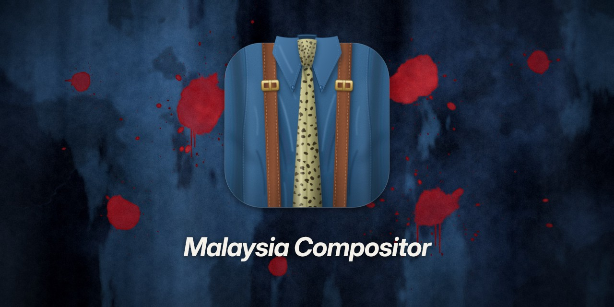

# Malaysia



Escritorio Wayland para NixOS. Su compositor, *Malaysia Compositor*
(`malaysia-compositor`), está construido sobre Smithay y se desarrolla bloque a bloque. La
documentación completa vive en [`docs/`](docs/README.md); el estado, en
[`docs/roadmap.md`](docs/roadmap.md).

> **Nota de repositorio (ADR 0048):** `barrier-kit`, `vow-design`,
> `vow-appearance` e `infinity-protocol` viven en
> [`github.com/HBlanqueto/barrierkit`](https://github.com/HBlanqueto/barrierkit).
> Este repo contiene el compositor, la shell, Ajustes y los portales.

> [!NOTE]
> Proyecto vibecoded, por gusto personal. Su uso previsto es el escritorio diario.

## NixOS

El flake expone `nixosModules.default`:

```nix
{
  inputs.malaysia.url = "github:HBlanqueto/malaysia";

  outputs = { nixpkgs, malaysia, ... }: {
    nixosConfigurations.mi-pc = nixpkgs.lib.nixosSystem {
      system = "x86_64-linux";
      modules = [
        malaysia.nixosModules.default
        { programs.malaysia.enable = true; }
      ];
    };
  };
}
```

`programs.malaysia.enable` instala el paquete, registra la sesión en el display
manager, crea `/etc/pam.d/malaysia-lock`, activa `hardware.graphics` y arranca
`malaysia-session.target` con `menubar`, `dock` y `wallpaper` (configurable con
`programs.malaysia.shellComponents`). El display manager ejecuta
`malaysia-compositor --drm`, la sesión directa del Bloque 8a.
## Datos generales

| Dato | Estado |
|---|---|
| Lenguaje | Rust (edición 2024) |
| Framework | Smithay, fijado por revisión (`023b78b1`, ADR 0028) |
| Backend | Winit anidado para desarrollo; DRM/KMS directo aceptado en panel real (8a) |
| Gráficos | EGL + OpenGL ES 3; Vulkan solo en clientes (p. ej. wallpaper, vkcube) |
| Shell | `malaysia-shell` nativa, un proceso por componente (ADR 0023) |
## Comandos

```sh
nix develop
./dev.sh build            # compila el workspace
./dev.sh run              # compositor anidado
./dev.sh demo             # shell + ventanas de prueba
./dev.sh lab              # shell + apps reales
./dev.sh check            # fmt + clippy + tests
./dev.sh titlebar         # cerrar/minimizar/maximizar
./dev.sh smoke            # mapeo de toplevels
./dev.sh drm-vkms         # Direct Session sobre vkms
nix build .#default       # paquete instalable
```

Cada componente de la shell es un proceso:

```sh
malaysia-wallpaper         # fondo (Vulkan/wgpu, ADR 0049)
malaysia-shell menubar     # barra superior
malaysia-shell dock        # dock
malaysia-shell lock        # bloqueo
malaysia-shell launcher    # launcher
```
## Configuración (ADR 0021)

La interfaz acordada es el comando `domain`, con la sintaxis de `defaults` de
macOS. Hablará con el compositor por D-Bus (`org.malaysia.Compositor1`); el
binario aún no existe:

```sh
domain read   <dominio> <clave>
domain write  <dominio> <clave> <valor> [-bool | -int | -float | -string]
domain delete <dominio> <clave>
domain rename <dominio> <antigua> <nueva>
domain find   <palabra>
domain domains
```

Un archivo TOML por dominio, como los `.plist` de macOS:

```text
~/.config/malaysia/                 preferencias
├── appearance.domain
├── window.domain
├── dock.domain
├── menubar.domain
├── lock.domain
├── display.domain
├── screenshot.domain
└── effects.domain

~/.local/share/malaysia/            estado y datos
├── wallpaper.domain            catálogo + selección
└── window.domain               app activa (la escribe el compositor)
```

Cada archivo es opcional; si falta, se usan los defaults.
`MALAYSIA_CONFIG_DIR` y `MALAYSIA_DATA_DIR` permiten otros directorios.
El catálogo completo, con tipos y estados, está en
[`docs/configuracion/opciones.md`](docs/configuracion/opciones.md).
## Documentación

- [`docs/README.md`](docs/README.md) — índice y cómo compilar/probar.
- [`docs/roadmap.md`](docs/roadmap.md) — estado por bloques y pendientes.
- [`docs/arquitectura/interfaz.md`](docs/arquitectura/interfaz.md) — mapa visual.
- [`docs/decisiones/`](docs/decisiones/) — ADR.
- [`docs/deuda.md`](docs/deuda.md) — deuda técnica abierta.
- [`docs/investigacion.md`](docs/investigacion.md) — conclusiones de macOS,
  GNOME y Otto.

`LICENSE` y `NOTICE` cubren la licencia y los avisos de terceros.
