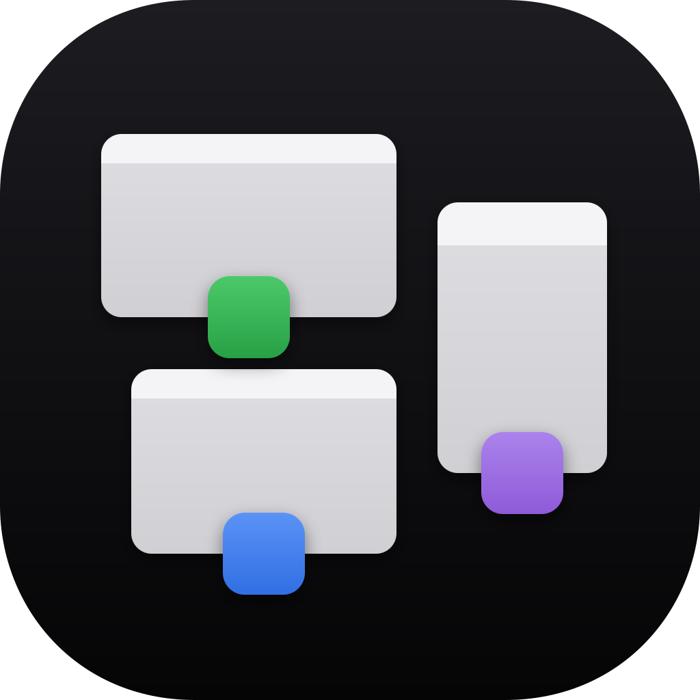

# Malaysia

Malaysia is a Wayland compositor written in Rust on
[Smithay](https://github.com/Smithay/smithay).

It is being rebuilt from its foundation, one dependency at a time. Today it
draws the windows and the menus of Wayland clients that use `xdg_shell` and
shared-memory buffers, and gives them a keyboard and a pointer. A HiDPI
display gets a scale chosen from its physical size and resolution, whole or
fractional. It tells BarrierKit apps, through `limitless_window_style_v1`, that
the compositor frames their windows, and it draws that frame on every window:
the continuous corner of macOS, an outline outside, an inner line inside and
the macOS shadow, stronger under the main window.
It runs in two ways:

- **Directly on a display.** Started from a TTY by a normal user, it takes its
  session from libseat, finds the GPU through udev, drives the display through
  DRM/KMS and reads the keyboard and the mouse through libinput.
- **Nested.** Started inside a Wayland session, it is a window of that desktop.

[ROADMAP.md](ROADMAP.md) says which step is in progress, what is missing and
what has not been verified. The proposal for full screen, Expansion
(malaysia's Mission Control) and Split View, all of it built, is in
[crates/malaysia-compositor/src/workspaces](crates/malaysia-compositor/src/workspaces/README.md). Nested, it has run on a laptop with a real GPU;
directly on a real display it has not run yet.

## Design

How the desktop is put together was decided on 2026-11-25, after reading how
GNOME, Plasma, COSMIC, niri, Hyprland and macOS do the same. None of it is
built yet; the roadmap says when each part comes.

| Part | Decision |
|---|---|
| Model | Separate processes. The compositor keeps capture, the lock protocol and the keyboard; the shell is a set of client processes, one per component. |
| System bus | D-Bus through `zbus`, for logind, localed, NetworkManager, BlueZ and UPower. |
| Start | systemd user units. The compositor is one unit; each shell component is started on demand by its D-Bus name. |
| Wi-Fi and Bluetooth | The menu bar calls NetworkManager and BlueZ directly through `zbus`. No crate per service and no daemon of our own in between. |
| Portal | Our own, from the start. Its picker is the permission to capture. Until it exists, sandboxed apps cannot capture or share the screen. |
| Screenshots | The compositor serves `ext-image-copy-capture`, checked with `grim`. A component of the shell comes later. |
| Lock screen | Our own client from the start: the `lock` component on `ext-session-lock`, with PAM. The compositor never draws the lock. |
| Clipboard | The compositor serves data control. The history lives in the launcher and is off by default. |
| Keyboard | The compositor applies the xkb layout and reads the default from localed. The menu bar shows the layout and asks for the change. Input methods are outside programs that use the standard protocol. |
| Language | Inherited from the system at login. A language per app is a variable set when the app is started, added when it is needed. |
| Settings | One process owns the settings files and announces each change on D-Bus. The compositor and the shell only listen. |

New dependencies, each added in the step that first needs it: `zbus`,
`pipewire` (screen sharing) and `pam-client` (unlocking). The Wayland
protocols named above are already in Smithay at the pinned rev.

## Build

The compositor needs Linux. The development shell comes from Nix:

```sh
nix develop
cargo build
```

`nix build` builds it as a package.

## Run

```sh
cargo run                      # nested inside a session, direct from a TTY
cargo run -- /dev/dri/card0    # directly on that DRM device, in any case
```

The compositor logs the backend it chose and the name of its Wayland socket,
normally `wayland-1`. It starts no program: clients reach it through that
name. It also logs why it stops (`stopping: …`): the host closed its window,
the quit key, or a signal (SIGTERM, SIGINT or SIGHUP). Nested, the last line
is always `the winit backend ended`; alone, it means the host went away.

`nix develop -c ./dev.sh demo` builds, starts the nested compositor and opens
a terminal (`foot`) in it. Closing the window or pressing Ctrl-C ends it.

```sh
WAYLAND_DISPLAY=wayland-1 foot
```

Directly on a display, Ctrl+Alt+Backspace quits and Ctrl+Alt+F1 to F12 switch
to another VT. In both ways Ctrl+Left and Ctrl+Right slide between Desktops
with macOS's spring, a black band of 64 between them. A window is dragged
by its own title bar, and Ctrl+Left or Ctrl+Right while it is held takes it
along to that Desktop.
The first window of a Desktop opens centred, a quarter of the free height
above it; each next one opens 29 right and 29 down from the one in front,
and a dialog opens over its parent. A new window is told the size of the
display (`configure_bounds`), so GTK 4 and Qt 6 apps open within it.
A window is resized by dragging its own edges and corners.
Ctrl+Super with F fills the display with the focused window, with C centres
it, with an arrow puts it in that half, and with R returns it to the frame it
had before it was tiled; Super stands in for macOS's fn.
A window that asks for full screen (`foot --fullscreen`, or the app's own
key, or Ctrl+Alt+F for the window in front) fills the display on a Space of
its own, right after its Desktop in the
row, growing in place while the row slides, and shrinks back to its frame
on that Desktop when it leaves, also after the Spaces are reordered. A new
window of another app that opens over it goes to Desktop 1, and the view
follows it when the app was just launched.
Ctrl+Alt+Left or Right puts the window in front on that half of a
full-screen Space and the window below it on the other, a black divider
between them; dragging the divider resizes both, and a double-click on it
makes them equal; when one leaves or closes, the other stays full screen
alone.
`RUST_LOG` sets the log level per module, for example
`RUST_LOG=smithay=debug`. `MALAYSIA_SCHEME=light` draws the window frame and
shadow in the light scheme; without it they are dark. `MALAYSIA_MOTION=reduced`
is Reduce Motion: every animation lands at once, as GNOME and KWin do with
animations off, while swipes still follow the fingers. Both are temporary,
until the appearance store exists and reads the portal's `color-scheme` and
`reduced-motion`.

### First run on a real machine

Directly on a display the screen is in graphics mode, so the log cannot be
read there and a second terminal is not at hand. This starts a terminal three
seconds after the compositor, keeps the log in a file, and ends the compositor
after two minutes in case the keyboard does not answer:

```sh
(sleep 3; WAYLAND_DISPLAY=wayland-1 foot) &
timeout 120 malaysia-compositor >~/malaysia.log 2>&1
```

What it needs:

- A logind session or seatd. No group membership is needed with logind.
- The active VT: start it from the TTY that is on the screen.
- polkit, for Ctrl+Alt+F1 to F12 under logind. Without it the switch is
  refused and logged.
- `XKB_DEFAULT_LAYOUT`, for a keyboard that is not US, for example
  `XKB_DEFAULT_LAYOUT=es`.
- Adwaita Sans, the desktop's font (`adwaita-fonts` in nixpkgs). The
  compositor asks for it by name and draws with another sans font when it is
  missing. To give it to the apps too, make it the system's default sans
  font, on NixOS with
  `fonts.fontconfig.defaultFonts.sansSerif = [ "Adwaita Sans" ];`.

Clients draw with software rendering for now.

## Expansion



Expansion is malaysia's Mission Control. Its desktop entry names this icon,
`org.malaysia.Expansion`, which the launcher and the Dock will show when they
exist.

Ctrl+Up spreads the windows of the Desktop with no overlap, a click picks
one, and Escape, Ctrl+Down or Ctrl+Up again puts them back. A strip at the
top then names the Desktops, a name too long for its cell ending in an
ellipsis; when the pointer enters it, it grows and shows
every Desktop live over its name. The strip blurs what is behind it. A click on one goes there, "+" adds a Desktop and the
close button of a thumbnail removes one. A window dragged onto the thumbnail
of another Desktop moves there, one dropped on "+" gets a new Desktop, and
one released anywhere else returns to its slot. The window under the pointer gets a ring in
the accent colour and its title in a capsule, and Ctrl+Left and Ctrl+Right slide the spread windows to
the next Desktop while the strip stays.
Inside Expansion, Alt+click on a thumbnail or Ctrl with a digit goes to that
Desktop and stays; near "+" a new Desktop peeks in from the right edge and a
click slides it into the row, after the last Desktop and before the
full-screen Spaces; a
thumbnail dragged along the strip changes the order; a held window grows
the strip and shrinks as it nears it, and over a full-screen thumbnail the
thumbnail shows the Split View that dropping it there makes, on the
pointer's side, the window keeping its own width; a released window flies
back to its slot, or into the thumbnail it was dropped on, and changes
Desktop when it lands; Space
enlarges the window under the pointer and Space again returns it; an empty
Desktop says "No Available Windows". Ctrl+Down, with Expansion closed,
spreads only the windows of the app in front, with their titles below
them (App Exposé), and Ctrl+Down, Ctrl+Up or Escape ends it.

`malaysia-expansion`, a second program of the package, opens Expansion or
closes it, as Ctrl+Up does, through the private protocol
`limitless_expansion_v1`; the package installs it with a desktop entry,
Expansion, and the icon above.
Directly on a display, three fingers on a touchpad up open Expansion and
down close it, and sideways slide to the next entry of the row, following
the fingers.

Progress, against the measures of macOS in BarrierKit's
[Mission Control research](https://github.com/HBlanqueto/barrierkit/blob/main/docs/research/macos-mission-control-2026-11-26.md):

- **Built:** the spread of the windows and its layout, the strip of Desktops
  and Spaces, dragging windows and thumbnails, the Split View preview, App
  Exposé, full-screen Spaces and Split View, the swipes and the private
  protocol.
- **Waits for the shell:** the menu bar and the Dock inside Expansion and in
  full screen, the bars that slide in at the top of a full-screen Space and
  «Assign To».
- **Missing:** the hot corner, the Mission Control key, the four-finger and
  pinch gestures, Spaces ordered by recent use, Show Desktop, Option to show
  every close button, several displays, and the shadow and
  corners of the windows in the strip's thumbnails.

## Check

```sh
cargo fmt --check
cargo clippy -- -D warnings
cargo test
nix build .#checks.<system>.vm
```

The last one boots a NixOS machine, logs a normal user in on a TTY, runs the
compositor directly on the virtual GPU, types into a terminal, moves the mouse
and checks the cursor, switches to another VT and back, types again, opens and closes a menu in a
text editor, sends it to full screen and back, makes a Split View and drags
its divider, opens Expansion by request and with three fingers on a virtual
touchpad, adds a Desktop and finds the "No Available Windows" capsule there
after Ctrl+2, goes to that Desktop by its thumbnail and by a swipe, and
quits. A second machine, whose display reports a small
1600x900 panel, checks that the compositor picks a scale of 5/3 and that the
cursor and a terminal are drawn at it.

On a Mac, `vm.sh` runs all of this in a Linux box that has a virtual display
and a headless desktop:

```sh
./vm.sh up
./vm.sh run nix develop -c cargo run -- /dev/dri/card0
./vm.sh shot screen.png        # capture the virtual display
./vm.sh test shots             # the NixOS machine check, with screenshots
```

## License

MIT. See [LICENSE](LICENSE).
