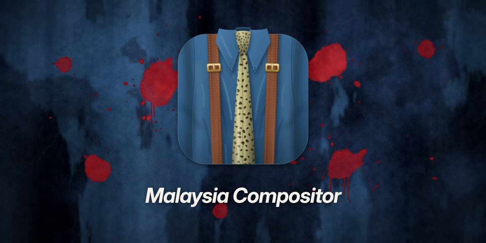

# Malaysia



Malaysia is a Wayland desktop for NixOS: a compositor built on Smithay, a
native shell, System Settings and an xdg-desktop-portal backend.

> [!NOTE]
> Vibecoded project, built for personal enjoyment. Its intended use is the daily desktop.

## Components

| Name | Identifier in code | macOS equivalent | Role |
|---|---|---|---|
| **Malaysia** | `malaysia` | Aqua | The complete desktop: compositor, shell, Settings and portals. It runs on NixOS. |
| **Malaysia Compositor** | `malaysia-compositor` | WindowServer | The Wayland compositor, on Smithay. It places, composes and applies the effects to every window. |
| **BarrierKit** | `bk` | AppKit | Toolkit of the shell and of Malaysia's own apps, built on Freya's core crates `=0.5.3` and the `ctdesign` tokens. It lives in [barrierkit](https://github.com/HBlanqueto/barrierkit). The compositor does not use it. |
| **Grade Graphics** | `grade-graphics` | Core Graphics + Core Text | The compositor's GLSL shaders (window shape, border, shadow, blur, glass) and their parameters. |
| **Grade Animation** | `bk::animation` | Core Animation | BarrierKit's animation module on `freya-animation`, with its own spring. The compositor does not use it. |
| **Infinity** | `infinity` | SkyLight | Private app↔compositor protocol: bar, panel, popover and card styles, glass, plates, knobs and the desktop of a surface. barrierkit owns the protocol crate; the compositor implements it. |

[`docs/architecture.md`](docs/architecture.md) explains how the processes fit
together.

## Install on NixOS

The flake exposes `nixosModules.default`:

```nix
{
  inputs.malaysia.url = "github:HBlanqueto/malaysia";

  outputs = { nixpkgs, malaysia, ... }: {
    nixosConfigurations.my-pc = nixpkgs.lib.nixosSystem {
      system = "x86_64-linux";
      modules = [
        malaysia.nixosModules.default
        { programs.malaysia.enable = true; }
      ];
    };
  };
}
```

`programs.malaysia.enable` installs the package and registers the session in
the display manager, which runs `malaysia-compositor --drm`. It creates
`/etc/pam.d/malaysia-lock`, enables `hardware.graphics` and starts
`malaysia-session.target` with the shell components and the wallpaper. It also
installs the [Malaysia icon theme](https://github.com/HBlanqueto/malaysia-icon-theme)
and makes it the default. The other module options are in
[`options.md`](docs/configuration/options.md#nixos-options-programsmalaysia).

## Build and test

Cargo only runs inside the dev shell; `build.rs` and `dev.sh` refuse to build
outside it.

```sh
nix develop
./dev.sh check            # fmt, clippy, links and tests
./dev.sh run              # nested compositor
./dev.sh demo             # nested session with the shell, Settings and test windows
./dev.sh --help           # every command and probe
nix build .#default       # installable package
```

To try a real DRM session on hardware without installing it:

1. `scripts/malaysia-drm.sh setup` builds `.#default` into `result/`.
2. On a text TTY, `scripts/malaysia-drm.sh run` starts `malaysia-compositor --drm`.
3. From another TTY, `scripts/malaysia-drm.sh client <program>` runs a program
   in that session; `lock`, `status` and `stop` do what they say.

## Documentation

- [`docs/architecture.md`](docs/architecture.md): processes, who draws, how they talk.
- [`docs/decisions.md`](docs/decisions.md): why it is built this way.
- [`docs/configuration/options.md`](docs/configuration/options.md): every
  `.domain` option, the fixed shortcuts and the NixOS options.

`LICENSE` and `NOTICE` cover the license and the third-party notices.
