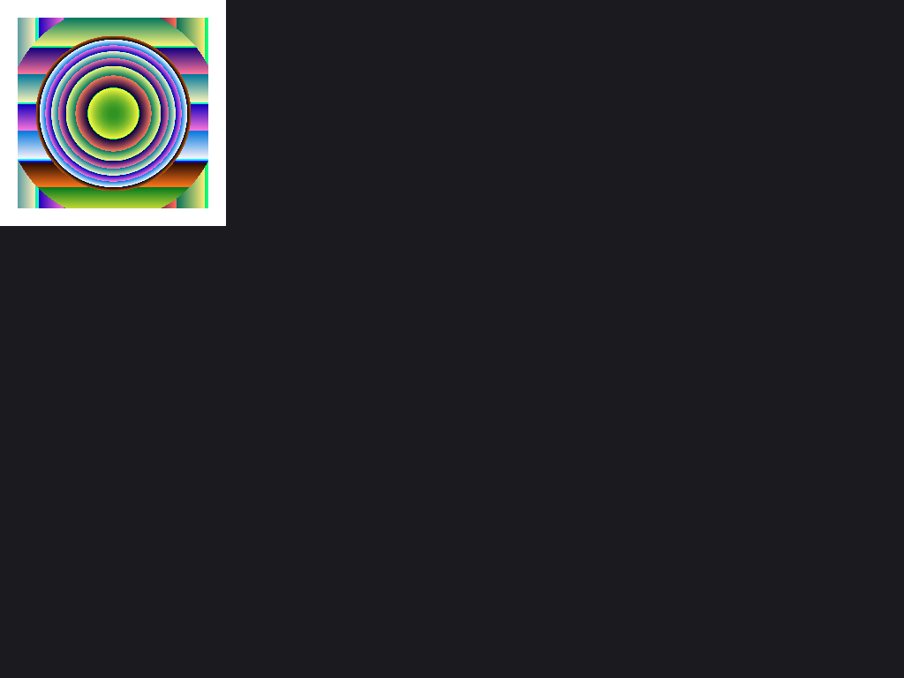

# Roadmap

Malaysia is being rebuilt from its foundation. Each step adds one dependency
or one Smithay feature and one result that can be seen. A step is done when it
passes `cargo fmt`, `cargo clippy -D warnings` and its run check, and is pushed
to `the-culling-branch`.

Last update: 2026-11-25.

## Where we are

**Now:** the compositor runs directly on a display and nested in a Wayland
session, apps show their menus, a HiDPI display gets a scale, whole or
fractional, a BarrierKit app leaves its frame to the compositor, and a
signal stops the compositor cleanly. Next is layer shell. `linux-dmabuf` waited for a real GPU, which the development
laptop now has. Nested, the compositor has run on that laptop's GPU; directly
on a real display it has not run yet.

The display after step 11 (on a NixOS machine whose display reports a
180x100 mm panel at 1600x900, directly on the display, a terminal drawn at a
scale of 5/3):

| Step | What it adds | What can be seen | State |
|---|---|---|---|
| 1 | Smithay, event loop, Wayland socket | a window with one color, nested | done `8bbad9a` |
| 2 | DRM/KMS output through GBM and GLES | the same color, directly on a display | done `da8a2c9` |
| 3 | Logging with `tracing` | Smithay's warnings and the compositor's own messages | done `017f0a4` |
| 4 | Windows: `wl_compositor`, `wl_shm`, `xdg_shell`, `wl_output` | an app drawn on the screen | done `80a5b31` |
| 5 | Nested session: the winit backend returns and shares the frame code with DRM | the compositor inside another desktop | done `7f75682` |
| 6 | Seat: keyboard and pointer | typing in a window | done `9427c17` |
| 7a | A Nix package and a NixOS test machine | the compositor on a virtual GPU in a full Linux session | done `8c058c3` |
| 7b | Session with libseat | start from a TTY as a normal user, pause and resume on VT switch | done `447a64a` |
| 8a | Devices with udev and libinput | real keyboard and mouse, the GPU found without an argument, Ctrl+Alt+Fn and Ctrl+Alt+Backspace | done `983e166` |
| 8b | Cursor | a pointer that can be seen on a real display | done `aa62ca9` |
| review | The whole code read against Smithay's source | fixes for focus, hidden errors and a retried frame | done `afa81d4` |
| 9 | Popups: `xdg_popup` with its keyboard and pointer grab | a menu, its submenus and a context menu that stays inside the display | done `5c5d116` |
| 10 | Output scale: 1 to 4, chosen from the display's physical size and mode with mutter's rule; nested, the host's scale | windows, menus and the cursor twice as large on a HiDPI panel | done `17d9fe9` |
| 11 | Fractional scale: `wp_fractional_scale_v1` and `wp_viewporter`, and mutter's fractional rule (steps of a half, a third and a quarter that divide the mode) | a terminal drawn sharp at 5/3 | done `44fba23` |
| 12 | `limitless`, the protocol shared with BarrierKit: the `limitless_window_style_v1` global at version 1 | a BarrierKit app leaves its frame and its round corners to the compositor, which does not draw them yet | done `da4b026` |
| 13 | Signals: `calloop`'s `signals` feature, so SIGTERM, SIGINT and SIGHUP stop the event loop | `./dev.sh demo` ended with Ctrl-C, or the compositor ended with `kill`, logs the signal and leaves no socket behind | done |
| review | An audit of the code on the Linux laptop | nested, the compositor stops when its host goes away and releases the keys when the host takes the keyboard; a menu whose grab is refused is closed | done |

Steps 1 to 8b were the first stage: the compositor runs directly on hardware
and nested in another session.

## After this stage

In the order they will be taken, one at a time:

1. `linux-dmabuf`: until then every client draws with software rendering, so a
   real machine looks slower than it is. It is written and kept out of the
   branch: it only turns on with a hardware render node, and the test machines
   have none. The development laptop has one since 2026-11-25, so it can be
   checked there. The steps below go ahead meanwhile.
2. Layer shell, which the shell needs to place its surfaces.
3. `bk` returns, with its first two components: the lock screen and the
   screen capture portal.
4. Hotplug and several displays.
5. What a laptop needs: display power and idle, touchpad settings such as
   tap-to-click.
6. Design tokens from `ctdesign`, window management (placement, move, resize),
   the rest of the shell and the apps.

## How the desktop is put together

The decisions and the new dependencies are in the «Design» section of
[README.md](README.md). None of it is built yet.

## What macOS does (measured, 2026-11-25)

Measured on macOS 27.2.1, one 2560×1440 display at 180 Hz, with the Dock
visible (autohide off), through `NSScreen`, `CGWindowList`, the accessibility
tree and screenshots. Sizes are points. Modes tried: 2560×1440 and 1920×1080
at scale 1, 1280×720 and 960×540 at scale 2.

- **Menu bar:** 30 in every mode. It is a window of its own, not part of the
  Dock.
- **Dock (tile 59):** the Dock is 79 high and 6 above the bottom edge, and the
  area it reserves is 85, from the same bottom edge, in all modes where it
  fits. At 960×540 it shrinks to 66 high and reserves 72, and its width is the
  screen minus 36 each side. With autohide on it reserves nothing. Its pill top
  edge matches the reserved edge in the pixels.
- **Windows:** the app decides the first position, not the system. A new window
  of the same app goes 29 right and 29 down from the previous one, and a
  Finder window (700×600) and a TextEdit window (603×505) both follow it. After
  a mode change the first window opened at 316,30, that is, clamped under the
  menu bar. Why it started at x 316 is not understood.
- **Dialogs:** a sheet is centered horizontally on its window (Finder's Go to
  Folder, 460 wide, sits 120 in from a 700 wide window and 102 below its top).
  The Open panel with no window is centered horizontally and its top is
  `(screen height − panel height) / 4 + 2`: 250 at 1440 and 160 at 1080 for a
  panel 448 high. Two points only.
- **Spaces:** the switch with Control+arrow is a slide with a fast start and a
  slow end. Its timing is in the later pass below.
- **Frames:** the display link ticks every 5.556 ms (180 Hz) with a spread of
  0.03 ms over 539 frames. Screen capture saw 11.1 ms gaps in about a quarter of
  the frames, and it cannot tell if the compositor or the capture caused them.

Later pass (2026-11-26), with the tables in barrierkit
`docs/research/macos-measurements-2026-11-26.md`:

- **Scale:** every value is in points. 1920×1080 at scale 1 gives the
  2560×1440 numbers, and 1280×720 at scale 2 doubles every pixel value.
- **Window shadow:** a blurred box moved down. The main window has σ 19.5, dy 18
  and alpha .689 dark or .393 light; any other window has σ 7.5, dy 7 and alpha
  .431 or .210. Dark is about twice light.
- **Space switch:** a spring with ω0 24 and ζ 1.73, 64 of gap between Spaces,
  about 1 s until the last pixel and t90 at about 325 ms. Mission Control is a
  critically damped spring (ω0 25) of about 260 ms.
- **Dock:** magnification 59 to 128 in about 115 ms with a radius of influence
  of 207; auto-hide waits about 250 ms; its glass blur is about 16.
- **Wallpaper tint:** one colour per window, the average of the wallpaper under
  the frame, mixed in encoded sRGB with k about .046 (dark window background)
  and about .045 for blurring materials; light windows are not tinted.
- **Not understood:** the window open shows no scale animation, and the menu
  bar ink and Control Center ignore the light scheme.

Not measured: banners and Notification Center, glass at slider 0, the system
switches (Reduce Transparency, Increase Contrast, Reduce Motion), mouse drag
and snap, more than one display.

## How each step is checked

On Linux the checks and `./dev.sh demo` (the nested session with a terminal)
run on the host inside `nix develop`. On a Mac, `vm.sh` gives a Linux box: Nix,
a virtual KMS display (`vkms`) for the direct backend and a headless desktop
for the nested one. `./vm.sh shot file.png` captures the virtual display.

With a device argument the compositor runs directly on that device. With no
argument it runs nested when `WAYLAND_DISPLAY` is set.

Nested input is checked without a person: the compositor runs inside a
headless sway with wayvnc, and a script sends pointer and key events over VNC.

Steps 7 and 8 need a seat, udev and a GPU, which the box of a Mac lacks. They
are checked in a NixOS virtual machine with a full Linux session, the flake's
`checks.<system>.vm` (on a Mac, `./vm.sh test dir` runs it and writes its
screenshots to `dir`). What only real hardware can prove is marked here as
**not verified on hardware** until someone runs it.

## Known gaps

- The compositor does not draw the frame or round the corners of windows yet,
  so a BarrierKit app is shown square and without a border.
- A click outside an open menu closes the menu and also reaches the window
  under it, without giving that window the focus. KWin keeps that click.
- When an app closes its own menu, the keyboard focus returns to the window on
  the next key or pointer event, not at once.
- Every window opens at the top left corner, over the others.
- The scale follows mutter's rule and cannot be set by hand. A 13.3 inch
  2560x1600 panel and a 14 inch 2880x1800 panel get 5/3 (KWin would give 2,
  niri 1.75), a 16 inch 2560x1600 panel 4/3, a 27 inch 4K monitor 1.5. A
  display that reports a wrong size gets a wrong scale, and one that reports
  none (a TV, a projector) gets 1.
- At 1.25 and 1.75 (a 14 inch 1920x1200 panel, for example) a decoration drawn
  as a subsurface, such as foot's title bar, sits one pixel low and loses a
  row: Smithay rounds a half pixel that way.
- A client without `wp_fractional_scale_v1` (GTK 3) draws at the next whole
  scale and is scaled down: the right size, a little soft.
- Above scale 1 a client that draws with `wl_shm` fills up to four times the
  pixels on the CPU, until `linux-dmabuf`.
- A client is not told which display its cursor is on, so some toolkits draw
  the cursor at scale 1 and it looks soft above it. foot and GTK are right.
- The fallback cursor is a white square: it shows where no client sets its
  own cursor. Cursor themes come later.
- The pointer starts at the top left corner.
- Nested, the host draws its own cursor; the client's cursor is not shown.
- Nested works inside a Wayland session only; an X11 host is not supported.
- The compositor starts no program; a client is started by hand.
- Under logind, switching VT with Ctrl+Alt+Fn needs polkit; without it the
  switch is refused and logged.
- Displays and GPUs are read once at start: no hotplug.
- The compositor must be started from the active VT; starting it from an
  inactive one is an error.
- A display mode is trusted as the kernel reports it; one with a zero total or
  a zero refresh would panic the compositor.
- Each frame that renders nothing inserts a one-shot timer to send its frame
  callbacks one refresh later; a reusable timer is not done.

## Not verified

- Real hardware: nested, the compositor has run on a laptop with an AMD GPU,
  with clients that draw through `wl_shm`. Directly on a display it has only
  run on virtual ones (vkms and QEMU's virtio GPU) with software rendering,
  and with QEMU's keyboard and mouse. A real GPU driver on the direct backend,
  a touchpad and several GPUs are untested.
- The hardware cursor plane: built without `renderer_pixman`, Smithay puts a
  client's cursor on the plane only when it is an ARGB8888 `wl_shm` buffer
  drawn at exactly the output's scale, uncropped, on an untransformed output
  and no larger than the plane; the white fallback square and every other
  cursor are drawn into the frame. Which path a real display takes has not
  been observed.
- Signals on the direct backend: the stop was checked nested only.
- A second signal while the compositor is stopping: by calloop's code it stays
  blocked until the signal source is dropped at the end of `main`, and then
  ends the process with that signal's status. Not exercised.
- A refused menu grab that closes the menu: it follows the protocol and
  mutter, and was not exercised, because no client here reaches the refused
  path.
- A page flip that the kernel never reports freezes the screen until the next
  VT switch; there is no page-flip watchdog.
- If the session cannot be resumed, drawing is retried on every refresh with a
  warning each time.
- A frame lost while the session is paused, and starting from a VT that is not
  the active one.
- Scroll, drag and drop and the clipboard.
- Scale on a real panel: the rule was checked with mutter's own table of
  displays and on a virtual display made to report a small panel, at 5/3. A
  client's own cursor above scale 1 on the direct backend, GTK 4 and Qt 6
  were not checked.
- Menus were checked with one GTK 3 app. A Qt app and a popup that asks to be
  moved after it is shown are untested.
