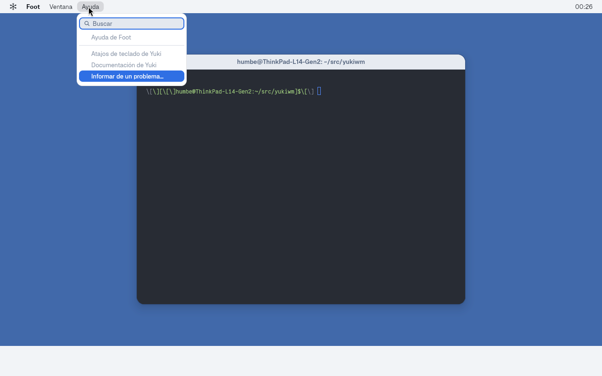

# Bloque 14 — Menú global

Estado: **14a aceptado** (popups y control de menú en CelestialKit, 2026-10-24,
ThinkPad, sesión anidada). **14b-1 implementado** (menús de escritorio en
`yuki-shell menubar`, 2026-10-24): falta el teclado en los menús y la aceptación
manual. **14c implementado** (2026-10-25, sesión anidada): menús de la app
enfocada con el respaldo de `.desktop`; la captura y la prueba funcional están
abajo, con las limitaciones del protocolo anotadas. 14b-2 (diálogos del
sistema) sigue pendiente.

## Qué hay hecho

- `celestial_kit::platform` crea popups `xdg_popup` anclados a una superficie
  `layer-shell` o a otro popup. Cada popup tiene su propio runner Freya, su
  contexto EGL/Skia y puede abrir hijos recursivamente.
- El compositor devuelve el foco de teclado al cerrar popups (commit
  `fix(compositor): devolver el foco de teclado al cerrar popups`). El orden
  es: popup padre con grab → layer con `Exclusive`/`OnDemand` → ventana que
  tenía el foco antes del popup → ventana activa → `None`.
- `celestial_kit::menu` expone `MenuView`, un control Neptunia para menús
  contextuales y globales:
  - Modelo `MenuItem::Action` / `Submenu` / `Separator`.
  - Navegación con `↑`/`↓`, `Home`, `End`, `→` abre submenús, `←` cierra el
    popup actual, `Enter`/`Space` activa la entrada enfocada.
  - Los separadores y los items deshabilitados se saltan al navegar.
  - Los submenús se abren como popups hijos con el ancla en el borde derecho
    del item.
  - Las acciones se reportan por callback; el cierre de toda la cascada es
    responsabilidad del callback `on_dismiss_all` que recibe la vista.
  - El control toma su paleta del tema activo a través de
    `celestial_kit::theme::menu_palette` (`MENU_LIGHT` / `MENU_DARK` /
    `MENU_DARK_TINT`). No hay colores fijos.
  - El ancho del panel está limitado por `shell.menu.panel.max-width` (480 px
    en Neptunia). Las etiquetas largas se truncan por el medio con «…»;
    atajos y chevrons nunca se ocultan ni se parten.
  - El menú raíz se ancla al borde inferior del rectángulo del título que lo
    abre: queda pegado a la barra, con el título resaltado mientras el menú
    permanece abierto.
  - Si no hay contexto de popup (previews, tests), `MenuView` se dibuja igual y
    simplemente no abre submenús.
  - Tests golden en `tests/golden/menu-view-{light,dark}.png` cubriendo item
    normal, resaltado, deshabilitado, atajo, casilla, radio, separador,
    chevron y truncado por el medio.

## API

```rust
use celestial_kit::menu::{CheckState, MenuItem, MenuView};
use celestial_kit::platform::{PopupSpec, Popups, PopupAnchor, PopupGravity};
use celestial_kit::theme;

let items = vec![
    MenuItem::Action {
        id: "new".to_string(),
        label: "New Window".to_string(),
        shortcut: Some("Ctrl+N".to_string()),
        enabled: true,
        check: CheckState::None,
    },
    MenuItem::Separator,
    MenuItem::Submenu { label: "Recent".to_string(), enabled: true, items: vec![] },
];
let palette = theme::menu_palette(&theme::resolved());
let view = MenuView::new(
    items,
    |id| eprintln!("activated {id}"),
    || { /* cerrar el popup raíz */ },
    palette,
);
```

## Ejemplo

`celestial-kit/examples/menu_popup.rs` levanta una barra `layer-shell` cuya
altura viene del token `MENUBAR_HEIGHT` de Neptunia y usa
`keyboard_interactivity = None`. Tiene entradas (`Yuki`, `Ir`, `Editar`)
que abren menús con submenús de dos niveles, casillas, radios y items
deshabilitados. El menú raíz se ancla al borde inferior del título (sin
espacio extra), y el título permanece resaltado mientras su menú esté abierto.
Los atajos se pasan como texto (`Ctrl+Shift+G`, `Alt+Inicio`) y el control
los formatea con los glifos de macOS (`⌃⇧G`, `⌥Inicio`) en el orden
`⌃⌥⇧❖`, sin `+` ni el glifo de Command.

Para muestras sin entrada real, `MENU_POPUP_SHOW=<caso>` abre el menú por la
API (sin grab) y lo deja abierto: `ir` abre «Ir» bajo su título, `editar-sub`
abre «Editar» con «Ordenar por» y «Orden» desplegados, y `borde` abre «Editar»
desde el borde derecho: el compositor voltea el raíz y el primer submenú a la
izquierda; el nieto, que cabe, abre a la derecha. La barra del ejemplo no
reserva zona exclusiva en este modo.

## Entrada simulada

`YUKI_TEST_INPUT` ya no se limita al botón de la titlebar. Con un script,
el compositor inyecta las acciones por el mismo camino que un ratón real:
`pointer_motion` actualiza el foco y `pointer_press`/`pointer.button` envían
el botón. No llama al cliente directamente.

La sintaxis es una lista separada por `;` con acciones de puntero y teclado:

- `move:x,y` mueve el puntero a `(x, y)` en coordenadas lógicas del output.
- `click:x,y` mueve, pulsa, espera 150 ms y suelta. La espera deja que el
  cliente pida `get_popup` y `grab` con el serial todavía pulsado.
- `key:<nombre>` pulsa y suelta una tecla por el camino real del teclado,
  con el keycode xkb (evdev + 8) y el estado `pressed`/`released`. Nombres
  soportados: `Up`, `Down`, `Left`, `Right`, `Return`, `Escape`, `Home`, `End`.
- `wait:ms` pausa la secuencia.

Mientras hay un script, el compositor descarta los eventos del ratón del host
para que la prueba sea determinista; las acciones inyectadas siguen pasando
por el mismo camino interno. Sin script, `YUKI_TEST_INPUT=1` conserva el
comportamiento anterior (pulsación sobre la primera ventana que mapea).

Ejemplo de aceptación con el demo y la barra de ejemplo:

```sh
./dev.sh demo   # en otra terminal
YUKI_TEST_INPUT='wait:9000;move:56,14;click:56,14;wait:1000' \
    ./dev.sh example menu_popup --sin-menubar
```

`./dev.sh example <nombre>` compila el ejemplo si hace falta, usa el socket
del demo, limpia `LD_LIBRARY_PATH` de rutas ajenas al dev shell y cierra la
menubar del demo con `--sin-menubar`.

## Aceptación con entrada simulada

La aceptación de 14a se hace con `./dev.sh example menu_popup --sin-menubar`
y un script de `YUKI_TEST_INPUT`:

- **a.** Un clic en «Ir» llega a la barra (`wl_pointer.enter`, `button`), el
  cliente pide `get_popup` y el compositor acepta el grab del raíz. Captura
  por `SIGUSR1` con el menú visible.
- **b.** Al mover sobre «Ordenar por» y «Orden» se abren el hijo y el nieto
  por hover real (`popup created` + `popup mapped`), y los tres niveles
  aceptan el grab encadenado.
- **c.** Un clic fuera envía `popup_done` al raíz y a toda la cascada; la
  captura posterior no muestra ningún menú.
- **d.** Un clic en una Action registra su id en el ejemplo y cierra todo.
- **e.** Con foot enfocado, abrir y cerrar el menú produce
  `wl_keyboard.leave` y después `wl_keyboard.enter` en foot.
- **f.** Navegación por teclado: abrir «Editar», bajar cinco veces hasta
  «Ordenar por» (saltando «Rehacer», separadores y items no seleccionables),
  `→` abre el submenú con «Nombre» enfocado y otro `key:Down` selecciona
  «Fecha». Se capturan los cuatro estados con `SIGUSR1`; la secuencia usa solo
  teclado. El runner fuerza un redraw de todas las superficies cuando un popup
  recibe una tecla, porque el compositor aún no repinta la salida solo por
  daño de popup.
- **g.** Un solo árbol abierto: abrir «Yuki» y luego pulsar «Editar» cierra el
  primero y abre el segundo; la captura muestra solo el menú de «Editar».

**Grab encadenado:** los submenús abiertos por hover piden `grab: true` con el
serial del clic que abrió su raíz. El compositor acepta el grab del hijo si su
padre ya lo tiene, es del mismo cliente y el serial es el de la cadena o uno
posterior entregado a ese cliente. Los tres niveles reciben
`popup grab accepted` y el hijo toma el foco de teclado; al cerrarlo, la pila
devuelve el foco al padre. Un hijo de un padre sin grab se sigue rechazando.

## 14b-1 — Menús de escritorio

Implementado el **2026-10-24**. Sin ventana enfocada la barra muestra, de
izquierda a derecha, el copo (glifo SVG), «Yuki» en negrita y los títulos
**Archivo**, **Edición**, **Visualización**, **Ir**, **Ventana** y **Ayuda**,
cada uno con su propio menú; el reloj queda a la derecha. Con una ventana
enfocada quedan el copo y el nombre de la app en negrita.

Contenido exacto de cada menú:

- **❄** (sistema): Acerca de este equipo · Ajustes del sistema… · — · Forzar
  salida… (`⌥❖⎋`) · — · Suspender · Reiniciar… · Apagar… · — · Bloquear
  pantalla · Cerrar sesión…
- **Yuki**: Acerca de Yuki · — · Ajustes… · — · Vaciar papelera…
- **Archivo**: Nueva ventana · Nueva carpeta en el escritorio · Abrir… · Buscar
- **Edición**: Deshacer · Cortar · Copiar · Pegar · Seleccionar todo
- **Visualización**: Mostrar/ocultar dock · Cambiar fondo de pantalla…
- **Ir**: Atrás · Adelante · — · Inicio · Escritorio · Documentos · Descargas ·
  Imágenes · Música · Vídeos · — · Papelera · — · Ir a la carpeta…
- **Ventana**: Minimizar todo · Mostrar escritorio · — · lista de ventanas (o
  «No hay ventanas abiertas» deshabilitado)
- **Ayuda**: Atajos de teclado · Documentación de Yuki

Habilitados: los de **Ir** salvo Atrás, Adelante e Ir a la carpeta…; Nueva
ventana, Nueva carpeta en el escritorio y Buscar; Minimizar todo, Mostrar
escritorio y la lista de ventanas; y Bloquear pantalla. Todo lo demás se ve
deshabilitado.

Cada título ancla su popup a su propio rectángulo. Solo hay un árbol abierto:
pulsar un título distinto cierra el anterior y, con un menú abierto, mover el
puntero a otro título abre el suyo. Los procesos externos (`yuki-shell lock`,
`yuki-shell launcher`, `xdg-open`) se lanzan sin heredar el entorno Mesa privado
del compositor: se eliminan `LD_LIBRARY_PATH`, `__EGL_VENDOR_LIBRARY_DIRS`,
`LIBGL_DRIVERS_PATH` y `GBM_BACKENDS_PATH`, se restauran los valores originales
desde `YUKI_ORIG_*` si existen, y se llama a `setsid()` para desvincular el
hijo. El compositor sirve `zwlr_foreign_toplevel_management_v1` v3 para
minimizar y activar la lista de ventanas; el copo y la barra reservan la zona
exclusiva de 28 px.

Pendiente: la navegación con teclado dentro de los menús y la aceptación manual.

### Aceptación de 14b-1

La aceptación se hace con `./dev.sh demo` y `YUKI_TEST_INPUT` para inyectar
puntero. Comprobaciones:

- El log del compositor mapea las ventanas con
  `origin { x: 0, y: 28 }`, debajo de la menubar.
- Sin ventanas, `Ir` → `Descargas` registra
  `menubar: xdg-open /home/humbe/Descargas`.
- Con `Ir` abierto, mover el puntero a `Ventana` abre su menú y cierra el de
  `Ir` (`popup subtree removed`).
- `Minimizar todo` registra `window minimized` para cada ventana y la lista de
  `Ventana` las sigue mostrando.

### Capturas de 14b-1


`barra-light.png`: barra sin ventanas sobre el wallpaper; copo, «Yuki» en
negrita, los títulos y el reloj.


`barra-dark.png`: la misma barra en oscuro.


`ir-light.png`: menú «Ir» bajo su título; los elementos habilitados y los
deshabilitados se distinguen.


`ir-dark.png`: el mismo menú en oscuro.


`ventana-light.png`: menú «Ventana» en claro con dos ventanas en la lista,
minimizadas para dejar ver el wallpaper.


`ventana-dark.png`: el mismo menú en oscuro.


`sistema-light.png`: menú del copo en claro, con «Bloquear pantalla»
habilitado y «Forzar salida…» con `⌥❖⎋`.


`sistema-dark.png`: el mismo menú en oscuro.


`foot-light.png`: `foot` enfocado; el nombre va en negrita y su barra de título
y semáforos quedan debajo de la menubar.


`foot-dark.png`: el mismo estado en oscuro.

## 14c — Menús de la app enfocada

Implementado el **2026-10-25**. Con una app enfocada la barra queda
**❄ · {App} · Ventana · Ayuda**; los tres títulos están habilitados y el nombre
va en negrita. Sin ventana enfocada no cambia nada del modo escritorio
(**Sistema**, **Yuki**, Archivo…).

### Piezas nuevas del kit

- `MenuItem::Action` y `MenuItem::Submenu` aceptan `icon: Option<&'static str>`.
  El SVG se dibuja a 14 px en la misma columna de 16 px que la marca de
  verificación (`✓`/radio): el icono no ensancha el menú. Color `ink-muted`
  normal, `on-accent` en la fila resaltada y `ink-faint` deshabilitado.
- `MenuItem::Header { label }`: 11 px, peso 600, `ink-faint`, sangrado a la
  columna del texto. No es seleccionable y el teclado lo salta.
- `MenuItem::SearchField { placeholder }`: campo de 26 px con `bg-control`,
  anillo de acento de 2 px y lupa. Por ahora es solo visual: no se selecciona y
  no filtra (el foco de teclado lo salta).
- `format_shortcut` añade `← → ↑ ↓`, `↩` (Return/Enter) y `⇥` (Tab).
- `ToplevelInfo` añade `maximized` y `minimized`, leídos del evento `State` de
  `zwlr_foreign_toplevel_management_v1`. `Toplevels` expone
  `set_maximized(index, bool)` y `unset_minimized(index)`.

### Menú {App}

Acerca de {App} [info] (gris) · — · Configuración… [gear] `❖,` (gris) · — ·
Servicios › (submenú habilitado; dentro «Ningún servicio disponible» y
«Ajustes de servicios…», grises) · — · Ocultar {App} `❖H` · Ocultar otros
`⌥❖H` · Mostrar todo · — · Salir de {App} `❖Q`.

«Ocultar otros» se habilita si alguna ventana de otra app no está minimizada;
«Mostrar todo» solo si hay alguna minimizada. Ocultar minimiza todas las
ventanas de la app; Salir cierra todas con `close()`.

### Menú Ventana

Minimizar `❖M` · Maximizar · Rellenar `⌃❖↩` (gris) · Centrar `⌃❖C` (gris) · —
· Trasladar y redimensionar › [grid] (submenú habilitado, todo gris dentro) ·
Ventana a pantalla completa › [split] (todo gris dentro) · — · Cerrar ventana
`❖W` · — · Traer todo al frente · Quitar ventana del conjunto (gris) · — ·
pestañas anteriores/siguientes `⌃⇧⇥`/`⌃⇥`, mover pestaña y unir ventanas
(gris) · — · una entrada por ventana de la app, `{App} — {título}` (o `{App}`
si el título está vacío o es igual), con `Checkbox(true)` en la activa y
`activate(index)` al pulsarla.

«Trasladar y redimensionar» contiene los headers **Mitades**, **Cuartos** y
**Disposición**, con los iconos de mitad/cuarto, `← → ↑ ↓` en los atajos y los
cuatro cuartos. «Maximizar» alterna `set_maximized` sobre la activa.

### Menú Ayuda

SearchField «Buscar» · Ayuda de {App} (gris) · — · Atajos de teclado de Yuki
(gris) · Documentación de Yuki (gris) · Informar de un problema… (abre
`https://github.com/HBlanqueto/yukiwm/issues` con `xdg_open`).

Los atajos solo se muestran; **no** se crean keybindings. Un solo árbol de menús
abierto a la vez lo sigue garantizando `menubar/menu.rs`. Todos los fondos
salen de `Resolved` (`reduce_transparency`, ADR 0038): no hay alfa fijo.

### Iconos

`menubar/icons.rs` dibuja los iconos de disposición con `viewBox` 16: marco
`x=1.25 y=2.25 w=13.5 h=11.5 rx=2.2`, trazo 1.3, y la zona rellena dentro de
`x 2..14, y 3..13`. `grid` es el marco con cruz, `split` el marco con línea
vertical; además hay `info` (círculo con i) y `gear`.

### Capturas


`10.png`: menú de Foot sobre la barra con el icono de info, el gear, Servicios
con chevron, Ocultar/Ocultar otros/Salir y los atajos `❖H`, `⌥❖H` y `❖Q`.


`11.png`: Ventana con Minimizar/Maximizar habilitados, Rellenar y Centrar
grises, los dos submenús, Cerrar ventana, la lista de ventanas de Foot y `✓` en
la activa.


`12.png`: el submenú de disposición, con los headers Mitades, Cuartos y
Disposición, los iconos de mitad/cuarto y los atajos con flechas.


`12b.png`: el submenú Ventana a pantalla completa con su icono split y todo
gris salvo el submenú que lo abre.


`11-dark.png`: el mismo Ventana en oscuro.



`ayuda.png` (extra, sin mockup): el buscador de 26 px con el anillo de acento y
la lupa, y solo «Informar de un problema…» habilitado.

Los mockups de `docs/bloques/img/14c/mockups/` no están en el repositorio; las
capturas se generaron con la especificación de este bloque y los nombres 10,
11, 12, 12b.

### Prueba funcional con `YUKI_TEST_INPUT`

Se lanzó `./dev.sh demo --light` con secuencias de puntero/teclado. Extractos
reales del log del compositor (se omiten las líneas de geometría):

**Ocultar Foot.** Antes: `parent` enfocado. Después de pulsar «Ocultar»:
`window minimized window=4` y el foco pasa a `csd`:

```text
app_id="io.github.hblanqueto.yuki.demo.parent" ... hidden=true minimized=true ... focused=false
app_id="io.github.hblanqueto.yuki.demo.csd"    ... hidden=false minimized=false ... focused=true focused=Some(WindowId(3))
```

**Mostrar todo.** `window restored window=4` y la ventana vuelve visible, sin
robar el foco a `csd`:

```text
app_id="io.github.hblanqueto.yuki.demo.parent" ... hidden=false minimized=false ... focused=false
app_id="io.github.hblanqueto.yuki.demo.csd"    ... hidden=false minimized=false ... focused=true focused=Some(WindowId(3))
```

**Minimizar.** `window minimized window=3`; la pila pasa de
`focused=Some(WindowId(3))` a `focused=Some(WindowId(4))` con la ventana 3
`hidden=true minimized=true`.

**Maximizar dos veces.** El menú envía `set_maximized`/`unset_maximized`, pero
el compositor todavía no implementa esas peticiones
(`crates/yuki/src/foreign.rs`, rama `_ => {}`): no hay
`window maximized`/`window restored` ni cambio de geometría. Queda pendiente
en el compositor.

**Cerrar ventana.** «Salir de {App}» produce `window removed windows=4
topmost=Some(WindowId(4))` y el foco pasa a la siguiente ventana. «Cerrar
ventana» usa el mismo `close()` sobre la activa.

**Una entrada de la lista.** Al pulsar la primera entrada de Foot el foco pasa
de `focused=Some(WindowId(1))` a `focused=Some(WindowId(0))` y el popup se
cierra.

### Limitaciones conocidas

- El compositor **no envía el evento `State` de wlr** ni implementa
  `set_maximized`/`unset_maximized`, y no emite `closed` en los handles de
  management. Por eso el menú usa el `active` de `State` cuando llega y, si no,
  recurre al título de `window.domain` y a la última ventana de la app; las
  minimizadas que oculta este proceso se recuerdan en memoria
  (`focused.rs`, comentarios `shortcut:`). Cuando el compositor complete el
  protocolo, esos respaldos se pueden borrar.
- En la sesión anidada con `window.domain` vacío la barra vuelve al modo
  escritorio; no hay «Mostrar todo» global en ese modo.

## Aceptación de 14a

Aceptado el **2026-10-24** en el ThinkPad, en sesión anidada, con prueba manual:

- Clic: abre el menú.
- Submenús por hover.
- Teclado: navegación con redibujado inmediato.
- Esc cierra por niveles (primero el popup más profundo).
- Clic fuera cierra toda la cascada.
- Un solo árbol abierto a la vez.
- Al cerrar, el foco vuelve a `foot`.
- `kill -9` del cliente no deja restos (ni popups huérfanos ni foco perdido).

## Capturas


`menubar-nombre-claro.png`: menubar real con `foot` enfocado; muestra «Foot»,
no el título de la ventana, en negrita y con la pila Geist.


`menubar-nombre-oscuro.png`: el mismo estado en tema oscuro, «Foot» en
`ink-strong`.

Sesión anidada (`./dev.sh demo`: wallpaper, menubar real, dock y ventanas) con
el ejemplo en cada caso y captura por `SIGUSR1`. Claro y oscuro se obtienen
escribiendo `color_scheme = "light"|"dark"` en `appearance.domain` y apuntando
`YUKI_CONFIG_DIR` a ese directorio para el demo y el ejemplo. El texto de los
menús sale en Geist; los glifos ⌃⌥⇧❖, en Inter (el respaldo fijo de la pila).


`ir-claro.png`: menú «Ir» en tema claro, «Inicio» resaltado y «⌥Inicio»,
«⇧❖D», «⌥❖L», etc. completos.


`ir-oscuro.png`: el mismo menú «Ir» en tema oscuro.


`editar-sub-claro.png`: «Editar» + «Ordenar por» + «Orden» (raíz, hijo y
nieto), con «Deshacer», «Nombre» y «Ascendente» resaltados; cada submenú
empieza a la altura de la fila que lo abre.


`editar-sub-oscuro.png`: el mismo árbol de tres niveles en oscuro.


`borde-claro.png`: «Editar» abierto desde el borde derecho; el compositor
voltea el raíz y sus descendientes hacia la izquierda. El árbol de tres niveles
queda entero a la izquierda, pegado al raíz sin solaparse.


`borde-flip-claro.png`: detalle del primer submenú «Nombre», volteado a la
izquierda por el compositor; su borde derecho coincide con el izquierdo del
raíz, su fila coincide con «Ordenar por» y el ejemplo no tiene ninguna rama
especial para abrirlo a la izquierda.


`borde-oscuro.png`: la misma disposición de borde en oscuro, con el borde
doble visible en los paneles.


`borde-doble-oscuro.png`: zoom ×4 del borde superior de un panel oscuro; se ve
la línea exterior negra (`window-outer`) y la interior clara (`window-inner`).


`teclado-1.png`: clic en «Editar»; el título se resalta y el menú se abre con
«Deshacer» enfocado, pegado al borde inferior de la barra.


`teclado-2.png`: `key:Down` × 5; el foco salta «Rehacer», separadores y items
no seleccionables hasta «Iconos».


`teclado-3.png`: `key:Right` abre el submenú con «Nombre» enfocado.


`teclado-4.png`: `key:Down` mueve el foco a «Fecha». La secuencia usa solo
teclado.


`menus-anchos.png`: mismo menú con los tokens ajustados: ancho mínimo 220 px,
`shortcut-gap` 24 px, relleno derecho 10 px y ancla pegada al borde inferior
de la barra con el título resaltado.


`pegado-a-la-barra.png`: menú «Ir» abierto; el panel arranca exactamente en el
borde inferior de la barra, sin espacio, y el título «Ir» permanece
resaltado.


`pegado-a-la-barra-zoom.png`: zoom ×4 de la unión entre el título resaltado y
el borde superior del panel; no hay hueco entre ambos.


`un-solo-arbol.png`: se abrió «Yuki» y se pulsó «Editar`; el menú de «Yuki» se
cerró y solo sobrevive el árbol de «Editar», demostrando que `toggle_menu`
/cierra el árbol anterior antes de abrir uno nuevo.

Nota de honestidad: la barra del ejemplo comparte la franja superior con el
menubar real del demo y queda debajo de él, así que el título visible sobre el
menú es el de la ventana activa, no las etiquetas «Ir»/«Editar»/«Borde» del
ejemplo. El menú sí está anclado en la posición de esas etiquetas.

## Divergencias

- **Prerrequisito de los popups de layer**: los menús no se veían hasta
  `ab8e0b5`; faltaba `WlrLayerShellHandler::new_popup` en el compositor y el
  primer buffer del cliente. Está corregido y documentado en la
  [nota del Bloque 5](05-popups.md#nota-2026-10-23-popups-hijos-de-layer-shell).
- **Sombra (`shadow-float`)**: el cliente no la dibuja. El panel solo pinta el
  fondo, los bordes `window-outer`/`window-inner` y el contenido; la sombra de
  la ventana flotante la aplicará el compositor, como indica ADR 0024. Esto
  evita que cada popup cliente renderice una sombra que luego el compositor
  componga de todos modos.

## Pendiente

- Repetir la prueba de 14a y 14b-1 en DRM real (pendiente de 8b/14b).
- 14b-2: diálogos del sistema (Suspender, Reiniciar, Apagar, Cerrar sesión).
- Compositor: emitir `State` (Activated/Maximized/Minimized y `closed`) en
  `zwlr_foreign_toplevel_management_v1` e implementar
  `set_maximized`/`unset_maximized`. Sin eso, Maximizar es un no-op y los
  respaldos de 14c siguen haciendo falta.
- Aceptación manual de 14c en DRM (con el protocolo completo).
- Navegación por teclado completa dentro de los popups (flechas, Esc, Enter)
  y atajos subrayados al pulsar `Alt`.
- Scroll para menús largos.
