# Bloque 14 — Menú global

Estado: **popups y control de menú implementados en CelestialKit** (2026-10-23).
La integración completa con `yuki-shell menubar` queda para el siguiente paso.

## Qué hay hecho

- `celestial_kit::platform` crea popups `xdg_popup` anclados a una superficie
  `layer-shell` o a otro popup. Cada popup tiene su propio runner Freya, su
  contexto EGL/Skia y puede abrir hijos recursivamente.
- El compositor devuelve el foco de teclado al cerrar popups (commit
  `fix(compositor): devolver el foco de teclado al cerrar popups`). El orden
  es: popup padre con grab → layer con `Exclusive`/`OnDemand` → ventana que
  tenía el foco antes del popup → ventana activa → `None`.
- `celestial_kit::menu` expone `MenuView`, un control Neptunia para menús
  contextuales y globales:
  - Modelo `MenuItem::Action` / `Submenu` / `Separator`.
  - Navegación con `↑`/`↓`, `Home`, `End`, `→` abre submenús, `←` cierra el
    popup actual, `Enter`/`Space` activa la entrada enfocada.
  - Los separadores y los items deshabilitados se saltan al navegar.
  - Los submenús se abren como popups hijos con el ancla en el borde derecho
    del item.
  - Las acciones se reportan por callback; el cierre de toda la cascada es
    responsabilidad del callback `on_dismiss_all` que recibe la vista.
  - El control toma su paleta del tema activo a través de
    `celestial_kit::theme::menu_palette` (`MENU_LIGHT` / `MENU_DARK` /
    `MENU_DARK_TINT`). No hay colores fijos.
  - Si no hay contexto de popup (previews, tests), `MenuView` se dibuja igual y
    simplemente no abre submenús.
  - Tests golden en `tests/golden/menu-view-{light,dark}.png` cubriendo item
    normal, resaltado, deshabilitado, atajo, casilla, radio, separador y
    chevron.

## API

```rust
use celestial_kit::menu::{CheckState, MenuItem, MenuView};
use celestial_kit::platform::{PopupSpec, Popups, PopupAnchor, PopupGravity};
use celestial_kit::theme;

let items = vec![
    MenuItem::Action {
        id: "new".to_string(),
        label: "New Window".to_string(),
        shortcut: Some("Ctrl+N".to_string()),
        enabled: true,
        check: CheckState::None,
    },
    MenuItem::Separator,
    MenuItem::Submenu { label: "Recent".to_string(), enabled: true, items: vec![] },
];
let palette = theme::menu_palette(&theme::resolved());
let view = MenuView::new(
    items,
    |id| eprintln!("activated {id}"),
    || { /* cerrar el popup raíz */ },
    palette,
);
```

## Ejemplo

`celestial-kit/examples/menu_popup.rs` levanta una barra `layer-shell` de 28 px
con `keyboard_interactivity = None`. Tiene entradas (`Yuki`, `Ir`, `Editar`)
que abren menús con submenús de dos niveles, casillas, radios y items
deshabilitados. Los atajos se pasan como texto (`Ctrl+Shift+G`, `Alt+Inicio`)
y el control los formatea con los glifos de macOS (`⌃⇧G`, `⌥Inicio`) en el
orden `⌃⌥⇧❖`, sin `+` ni el glifo de Command.

Para muestras sin entrada real, `MENU_POPUP_SHOW=<caso>` abre el menú por la
API (sin grab) y lo deja abierto: `ir` abre «Ir» bajo su título, `editar-sub`
abre «Editar» con «Ordenar por» y «Orden» desplegados, y `borde` abre «Editar»
desde el borde derecho: el compositor voltea el raíz y el primer submenú a la
izquierda; el nieto, que cabe, abre a la derecha. La barra del ejemplo no
reserva zona exclusiva en este modo.

## Entrada simulada

`YUKI_TEST_INPUT` ya no se limita al botón de la titlebar. Con un script,
el compositor inyecta las acciones por el mismo camino que un ratón real:
`pointer_motion` actualiza el foco y `pointer_press`/`pointer.button` envían
el botón. No llama al cliente directamente.

La sintaxis es una lista separada por `;` con acciones de puntero y teclado:

- `move:x,y` mueve el puntero a `(x, y)` en coordenadas lógicas del output.
- `click:x,y` mueve, pulsa, espera 150 ms y suelta. La espera deja que el
  cliente pida `get_popup` y `grab` con el serial todavía pulsado.
- `key:<nombre>` pulsa y suelta una tecla por el camino real del teclado,
  con el keycode xkb (evdev + 8) y el estado `pressed`/`released`. Nombres
  soportados: `Up`, `Down`, `Left`, `Right`, `Return`, `Escape`, `Home`, `End`.
- `wait:ms` pausa la secuencia.

Mientras hay un script, el compositor descarta los eventos del ratón del host
para que la prueba sea determinista; las acciones inyectadas siguen pasando
por el mismo camino interno. Sin script, `YUKI_TEST_INPUT=1` conserva el
comportamiento anterior (pulsación sobre la primera ventana que mapea).

Ejemplo de aceptación con el demo y la barra de ejemplo:

```sh
./dev.sh demo   # en otra terminal
YUKI_TEST_INPUT='wait:9000;move:56,14;click:56,14;wait:1000' \
    ./dev.sh example menu_popup --sin-menubar
```

`./dev.sh example <nombre>` compila el ejemplo si hace falta, usa el socket
del demo, limpia `LD_LIBRARY_PATH` de rutas ajenas al dev shell y cierra la
menubar del demo con `--sin-menubar`.

## Aceptación con entrada simulada

La aceptación de 14a se hace con `./dev.sh example menu_popup --sin-menubar`
y un script de `YUKI_TEST_INPUT`:

- **a.** Un clic en «Ir» llega a la barra (`wl_pointer.enter`, `button`), el
  cliente pide `get_popup` y el compositor acepta el grab del raíz. Captura
  por `SIGUSR1` con el menú visible.
- **b.** Al mover sobre «Ordenar por» y «Orden» se abren el hijo y el nieto
  por hover real (`popup created` + `popup mapped`), y los tres niveles
  aceptan el grab encadenado.
- **c.** Un clic fuera envía `popup_done` al raíz y a toda la cascada; la
  captura posterior no muestra ningún menú.
- **d.** Un clic en una Action registra su id en el ejemplo y cierra todo.
- **e.** Con foot enfocado, abrir y cerrar el menú produce
  `wl_keyboard.leave` y después `wl_keyboard.enter` en foot.
- **f.** Navegación por teclado: abrir «Editar», bajar cinco veces hasta
  «Ordenar por» (saltando «Rehacer» y los separadores), y `→` abre el submenú
  con «Nombre» enfocado. Se captura con `SIGUSR1`.
- **g.** Un solo árbol abierto: abrir «Yuki» y luego pulsar «Editar» cierra el
  primero y abre el segundo; la captura muestra solo el menú de «Editar».

**Grab encadenado:** los submenús abiertos por hover piden `grab: true` con el
serial del clic que abrió su raíz. El compositor acepta el grab del hijo si su
padre ya lo tiene, es del mismo cliente y el serial es el de la cadena o uno
posterior entregado a ese cliente. Los tres niveles reciben
`popup grab accepted` y el hijo toma el foco de teclado; al cerrarlo, la pila
devuelve el foco al padre. Un hijo de un padre sin grab se sigue rechazando.

## Capturas

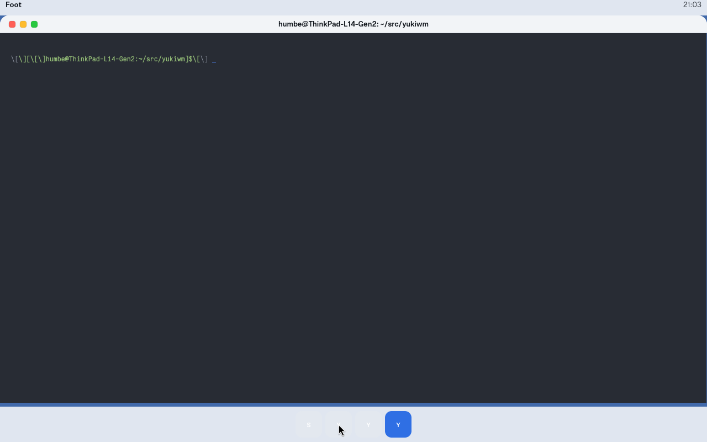

`menubar-nombre-claro.png`: menubar real con `foot` enfocado; muestra «Foot»,
no el título de la ventana, en negrita y con la pila Geist.

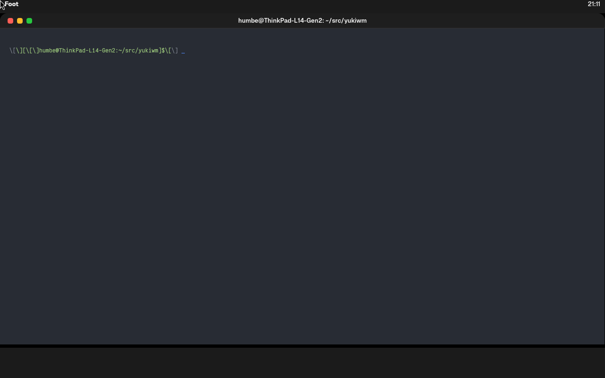

`menubar-nombre-oscuro.png`: el mismo estado en tema oscuro, «Foot» en
`ink-strong`.

Sesión anidada (`./dev.sh demo`: wallpaper, menubar real, dock y ventanas) con
el ejemplo en cada caso y captura por `SIGUSR1`. Claro y oscuro se obtienen
escribiendo `color_scheme = "light"|"dark"` en `appearance.domain` y apuntando
`YUKI_CONFIG_DIR` a ese directorio para el demo y el ejemplo. El texto de los
menús sale en Geist; los glifos ⌃⌥⇧❖, en Inter (el respaldo fijo de la pila).

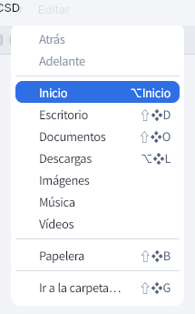

`ir-claro.png`: menú «Ir» en tema claro, «Inicio» resaltado y «⌥Inicio»,
«⇧❖D», «⌥❖L», etc. completos.

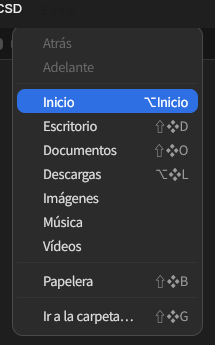

`ir-oscuro.png`: el mismo menú «Ir» en tema oscuro.

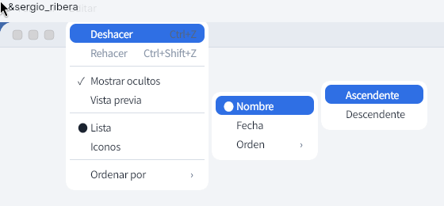

`editar-sub-claro.png`: «Editar» + «Ordenar por» + «Orden» (raíz, hijo y
nieto), con «Deshacer», «Nombre» y «Ascendente» resaltados; cada submenú
empieza a la altura de la fila que lo abre.

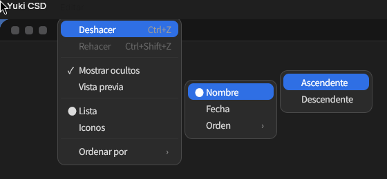

`editar-sub-oscuro.png`: el mismo árbol de tres niveles en oscuro.

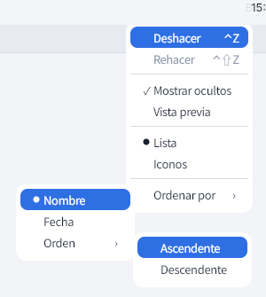

`borde-claro.png`: «Editar» abierto desde el borde derecho; el compositor
voltea el raíz y sus descendientes hacia la izquierda. El árbol de tres niveles
queda entero a la izquierda, pegado al raíz sin solaparse.

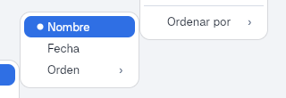

`borde-flip-claro.png`: detalle del primer submenú «Nombre», volteado a la
izquierda por el compositor; su borde derecho coincide con el izquierdo del
raíz, su fila coincide con «Ordenar por» y el ejemplo no tiene ninguna rama
especial para abrirlo a la izquierda.

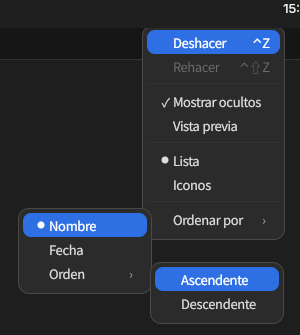

`borde-oscuro.png`: la misma disposición de borde en oscuro, con el borde
doble visible en los paneles.

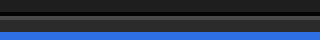

`borde-doble-oscuro.png`: zoom ×4 del borde superior de un panel oscuro; se ve
la línea exterior negra (`window-outer`) y la interior clara (`window-inner`).

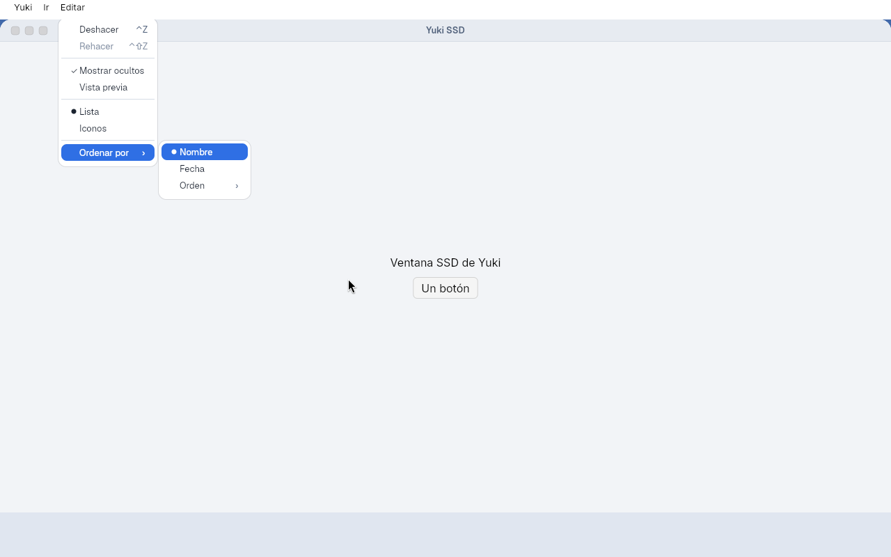

`teclado-submenu.png`: «Editar» abierto con teclado, «Ordenar por» resaltado y
su submenú visible con «Nombre» enfocado. La secuencia inyectada fue
`key:Down` × 5 y `key:Right`; un último `move` fuerza el redibujado del buffer
antes de la captura.

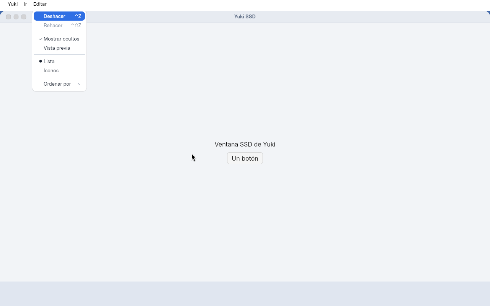

`un-solo-arbol.png`: se abrió «Yuki» y se pulsó «Editar`; el menú de «Yuki» se
cerró y solo sobrevive el árbol de «Editar», demostrando que `toggle_menu`
/cierra el árbol anterior antes de abrir uno nuevo.

Nota de honestidad: la barra del ejemplo comparte la franja superior con el
menubar real del demo y queda debajo de él, así que el título visible sobre el
menú es el de la ventana activa, no las etiquetas «Ir»/«Editar»/«Borde» del
ejemplo. El menú sí está anclado en la posición de esas etiquetas.

## Divergencias

- **Prerrequisito de los popups de layer**: los menús no se veían hasta
  `ab8e0b5`; faltaba `WlrLayerShellHandler::new_popup` en el compositor y el
  primer buffer del cliente. Está corregido y documentado en la
  [nota del Bloque 5](05-popups.md#nota-2026-10-23-popups-hijos-de-layer-shell).
- **Sombra (`shadow-float`)**: el cliente no la dibuja. El panel solo pinta el
  fondo, los bordes `window-outer`/`window-inner` y el contenido; la sombra de
  la ventana flotante la aplicará el compositor, como indica ADR 0024. Esto
  evita que cada popup cliente renderice una sombra que luego el compositor
  componga de todos modos.

## Pendiente

- Conectar el menú del `yuki-shell menubar` con `MenuView` y el estado de la
  aplicación activa (lectura de `~/.local/share/yuki/window.domain`).
- Atajos de teclado: mostrar el acelerador subrayado cuando el usuario pulsa
  `Alt`.
- Scroll para menús largos.
