# Bloque 14 — Menú global

Estado: **14a aceptado** (popups y control de menú en CelestialKit, 2026-10-24,
ThinkPad, sesión anidada). **14b-1 implementado** (menús de escritorio en
`yuki-shell menubar`, 2026-10-24): falta el teclado en los menús y la aceptación
manual. **14c implementado** (2026-10-25, sesión anidada): menús de la app
enfocada con el respaldo de `.desktop`; el compositor ya emite el `state`
completo de wlr, `closed` e implementa `set_maximized`/`unset_maximized`, así
que la barra usa solo `ToplevelInfo`. La captura y la prueba funcional están
abajo. 14b-2 (diálogos del sistema) sigue pendiente.

## Qué hay hecho

- `celestial_kit::platform` crea popups `xdg_popup` anclados a una superficie
  `layer-shell` o a otro popup. Cada popup tiene su propio runner Freya, su
  contexto EGL/Skia y puede abrir hijos recursivamente.
- El compositor devuelve el foco de teclado al cerrar popups (commit
  `fix(compositor): devolver el foco de teclado al cerrar popups`). El orden
  es: popup padre con grab → layer con `Exclusive`/`OnDemand` → ventana que
  tenía el foco antes del popup → ventana activa → `None`.
- `celestial_kit::menu` expone `MenuView`, un control Neptunia para menús
  contextuales y globales:
  - Modelo `MenuItem::Action` / `Submenu` / `Separator`.
  - Navegación con `↑`/`↓`, `Home`, `End`, `→` abre submenús, `←` cierra el
    popup actual, `Enter`/`Space` activa la entrada enfocada.
  - Los separadores y los items deshabilitados se saltan al navegar.
  - Los submenús se abren como popups hijos con el ancla en el borde derecho
    del item.
  - Las acciones se reportan por callback; el cierre de toda la cascada es
    responsabilidad del callback `on_dismiss_all` que recibe la vista.
  - El control toma su paleta del tema activo a través de
    `celestial_kit::theme::menu_palette` (`MENU_LIGHT` / `MENU_DARK` /
    `MENU_DARK_TINT`). No hay colores fijos.
  - El ancho del panel está limitado por `shell.menu.panel.max-width` (480 px
    en Neptunia). Las etiquetas largas se truncan por el medio con «…»;
    atajos y chevrons nunca se ocultan ni se parten.
  - El menú raíz se ancla al borde inferior del rectángulo del título que lo
    abre: queda pegado a la barra, con el título resaltado mientras el menú
    permanece abierto.
  - Si no hay contexto de popup (previews, tests), `MenuView` se dibuja igual y
    simplemente no abre submenús.
  - Tests golden en `tests/golden/menu-view-{light,dark}.png` cubriendo item
    normal, resaltado, deshabilitado, atajo, casilla, radio, separador,
    chevron y truncado por el medio.

## API

```rust
use celestial_kit::menu::{CheckState, MenuItem, MenuView};
use celestial_kit::platform::{PopupSpec, Popups, PopupAnchor, PopupGravity};
use celestial_kit::theme;

let items = vec![
    MenuItem::Action {
        id: "new".to_string(),
        label: "New Window".to_string(),
        shortcut: Some("Ctrl+N".to_string()),
        enabled: true,
        check: CheckState::None,
        icon: None,
    },
    MenuItem::Separator,
    MenuItem::Submenu { label: "Recent".to_string(), enabled: true, items: vec![], icon: None },
];
let palette = theme::menu_palette(&theme::resolved());
let view = MenuView::new(
    items,
    |id| eprintln!("activated {id}"),
    || { /* cerrar el popup raíz */ },
    palette,
);
```

## Ejemplo

`celestial-kit/examples/menu_popup.rs` levanta una barra `layer-shell` cuya
altura viene del token `MENUBAR_HEIGHT` de Neptunia y usa
`keyboard_interactivity = None`. Tiene entradas (`Yuki`, `Ir`, `Editar`)
que abren menús con submenús de dos niveles, casillas, radios y items
deshabilitados. El menú raíz se ancla al borde inferior del título (sin
espacio extra), y el título permanece resaltado mientras su menú esté abierto.
Los atajos se pasan como texto (`Ctrl+Shift+G`, `Alt+Inicio`) y el control
los formatea con los glifos de macOS (`⌃⇧G`, `⌥Inicio`) en el orden
`⌃⌥⇧❖`, sin `+` ni el glifo de Command.

Para muestras sin entrada real, `MENU_POPUP_SHOW=<caso>` abre el menú por la
API (sin grab) y lo deja abierto: `ir` abre «Ir» bajo su título, `editar-sub`
abre «Editar» con «Ordenar por» y «Orden» desplegados, y `borde` abre «Editar»
desde el borde derecho: el compositor voltea el raíz y el primer submenú a la
izquierda; el nieto, que cabe, abre a la derecha. La barra del ejemplo no
reserva zona exclusiva en este modo.

## Entrada simulada

`YUKI_TEST_INPUT` ya no se limita al botón de la titlebar. Con un script,
el compositor inyecta las acciones por el mismo camino que un ratón real:
`pointer_motion` actualiza el foco y `pointer_press`/`pointer.button` envían
el botón. No llama al cliente directamente.

La sintaxis es una lista separada por `;` con acciones de puntero y teclado:

- `move:x,y` mueve el puntero a `(x, y)` en coordenadas lógicas del output.
- `click:x,y` mueve, pulsa, espera 150 ms y suelta. La espera deja que el
  cliente pida `get_popup` y `grab` con el serial todavía pulsado.
- `key:<nombre>` pulsa y suelta una tecla por el camino real del teclado,
  con el keycode xkb (evdev + 8) y el estado `pressed`/`released`. Nombres
  soportados: `Up`, `Down`, `Left`, `Right`, `Return`, `Escape`, `Home`, `End`.
- `wait:ms` pausa la secuencia.

Mientras hay un script, el compositor descarta los eventos del ratón del host
para que la prueba sea determinista; las acciones inyectadas siguen pasando
por el mismo camino interno. Sin script, `YUKI_TEST_INPUT=1` conserva el
comportamiento anterior (pulsación sobre la primera ventana que mapea).

Ejemplo de aceptación con el demo y la barra de ejemplo:

```sh
./dev.sh demo   # en otra terminal
YUKI_TEST_INPUT='wait:9000;move:56,14;click:56,14;wait:1000' \
    ./dev.sh example menu_popup --sin-menubar
```

`./dev.sh example <nombre>` compila el ejemplo si hace falta, usa el socket
del demo, limpia `LD_LIBRARY_PATH` de rutas ajenas al dev shell y cierra la
menubar del demo con `--sin-menubar`.

## Aceptación con entrada simulada

La aceptación de 14a se hace con `./dev.sh example menu_popup --sin-menubar`
y un script de `YUKI_TEST_INPUT`:

- **a.** Un clic en «Ir» llega a la barra (`wl_pointer.enter`, `button`), el
  cliente pide `get_popup` y el compositor acepta el grab del raíz. Captura
  por `SIGUSR1` con el menú visible.
- **b.** Al mover sobre «Ordenar por» y «Orden» se abren el hijo y el nieto
  por hover real (`popup created` + `popup mapped`), y los tres niveles
  aceptan el grab encadenado.
- **c.** Un clic fuera envía `popup_done` al raíz y a toda la cascada; la
  captura posterior no muestra ningún menú.
- **d.** Un clic en una Action registra su id en el ejemplo y cierra todo.
- **e.** Con foot enfocado, abrir y cerrar el menú produce
  `wl_keyboard.leave` y después `wl_keyboard.enter` en foot.
- **f.** Navegación por teclado: abrir «Editar», bajar cinco veces hasta
  «Ordenar por» (saltando «Rehacer», separadores y items no seleccionables),
  `→` abre el submenú con «Nombre» enfocado y otro `key:Down` selecciona
  «Fecha». Se capturan los cuatro estados con `SIGUSR1`; la secuencia usa solo
  teclado. El runner fuerza un redraw de todas las superficies cuando un popup
  recibe una tecla, porque el compositor aún no repinta la salida solo por
  daño de popup.
- **g.** Un solo árbol abierto: abrir «Yuki» y luego pulsar «Editar» cierra el
  primero y abre el segundo; la captura muestra solo el menú de «Editar».

**Grab encadenado:** los submenús abiertos por hover piden `grab: true` con el
serial del clic que abrió su raíz. El compositor acepta el grab del hijo si su
padre ya lo tiene, es del mismo cliente y el serial es el de la cadena o uno
posterior entregado a ese cliente. Los tres niveles reciben
`popup grab accepted` y el hijo toma el foco de teclado; al cerrarlo, la pila
devuelve el foco al padre. Un hijo de un padre sin grab se sigue rechazando.

## 14b-1 — Menús de escritorio

Implementado el **2026-10-24**. Sin ventana enfocada la barra muestra, de
izquierda a derecha, el copo (glifo SVG), «Yuki» en negrita y los títulos
**Archivo**, **Edición**, **Visualización**, **Ir**, **Ventana** y **Ayuda**,
cada uno con su propio menú; el reloj queda a la derecha. Con una ventana
enfocada quedan el copo y el nombre de la app en negrita.

Contenido exacto de cada menú:

- **❄** (sistema): Acerca de este equipo · Ajustes del sistema… · — · Forzar
  salida… (`⌥❖⎋`) · — · Suspender · Reiniciar… · Apagar… · — · Bloquear
  pantalla · Cerrar sesión…
- **Yuki**: Acerca de Yuki · — · Ajustes… · — · Vaciar papelera…
- **Archivo**: Nueva ventana · Nueva carpeta en el escritorio · Abrir… · Buscar
- **Edición**: Deshacer · Cortar · Copiar · Pegar · Seleccionar todo
- **Visualización**: Mostrar/ocultar dock · Cambiar fondo de pantalla…
- **Ir**: Atrás · Adelante · — · Inicio · Escritorio · Documentos · Descargas ·
  Imágenes · Música · Vídeos · — · Papelera · — · Ir a la carpeta…
- **Ventana**: Minimizar todo · Mostrar escritorio · — · lista de ventanas (o
  «No hay ventanas abiertas» deshabilitado)
- **Ayuda**: Atajos de teclado · Documentación de Yuki

Habilitados: los de **Ir** salvo Atrás, Adelante e Ir a la carpeta…; Nueva
ventana, Nueva carpeta en el escritorio y Buscar; Minimizar todo, Mostrar
escritorio y la lista de ventanas; y Bloquear pantalla. Todo lo demás se ve
deshabilitado.

Cada título ancla su popup a su propio rectángulo. Solo hay un árbol abierto:
pulsar un título distinto cierra el anterior y, con un menú abierto, mover el
puntero a otro título abre el suyo. Los procesos externos (`yuki-shell lock`,
`yuki-shell launcher`, `xdg-open`) se lanzan sin heredar el entorno Mesa privado
del compositor: se eliminan `LD_LIBRARY_PATH`, `__EGL_VENDOR_LIBRARY_DIRS`,
`LIBGL_DRIVERS_PATH` y `GBM_BACKENDS_PATH`, se restauran los valores originales
desde `YUKI_ORIG_*` si existen, y se llama a `setsid()` para desvincular el
hijo. El compositor sirve `zwlr_foreign_toplevel_management_v1` v3 para
minimizar y activar la lista de ventanas; el copo y la barra reservan la zona
exclusiva de 28 px.

Pendiente: la navegación con teclado dentro de los menús y la aceptación manual.

### Aceptación de 14b-1

La aceptación se hace con `./dev.sh demo` y `YUKI_TEST_INPUT` para inyectar
puntero. Comprobaciones:

- El log del compositor mapea las ventanas con
  `origin { x: 0, y: 28 }`, debajo de la menubar.
- Sin ventanas, `Ir` → `Descargas` registra
  `menubar: xdg-open /home/humbe/Descargas`.
- Con `Ir` abierto, mover el puntero a `Ventana` abre su menú y cierra el de
  `Ir` (`popup subtree removed`).
- `Minimizar todo` registra `window minimized` para cada ventana y la lista de
  `Ventana` las sigue mostrando.

### Capturas de 14b-1

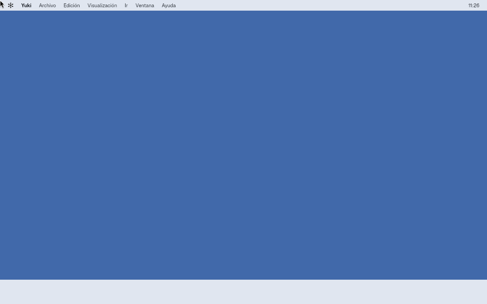

`barra-light.png`: barra sin ventanas sobre el wallpaper; copo, «Yuki» en
negrita, los títulos y el reloj.

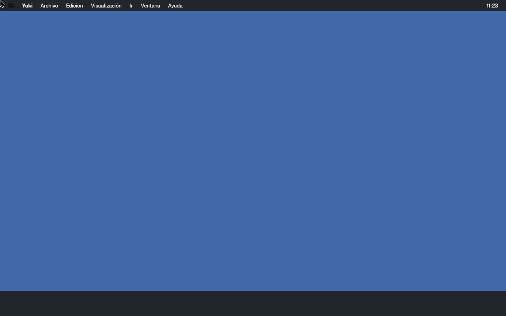

`barra-dark.png`: la misma barra en oscuro.

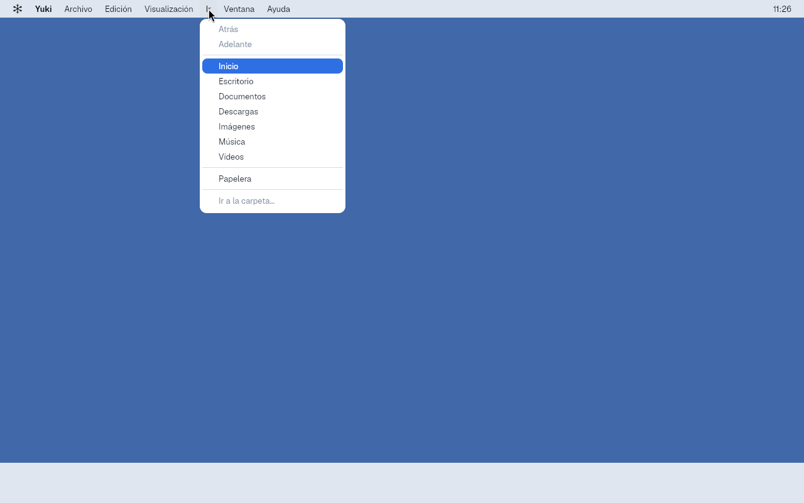

`ir-light.png`: menú «Ir» bajo su título; los elementos habilitados y los
deshabilitados se distinguen.

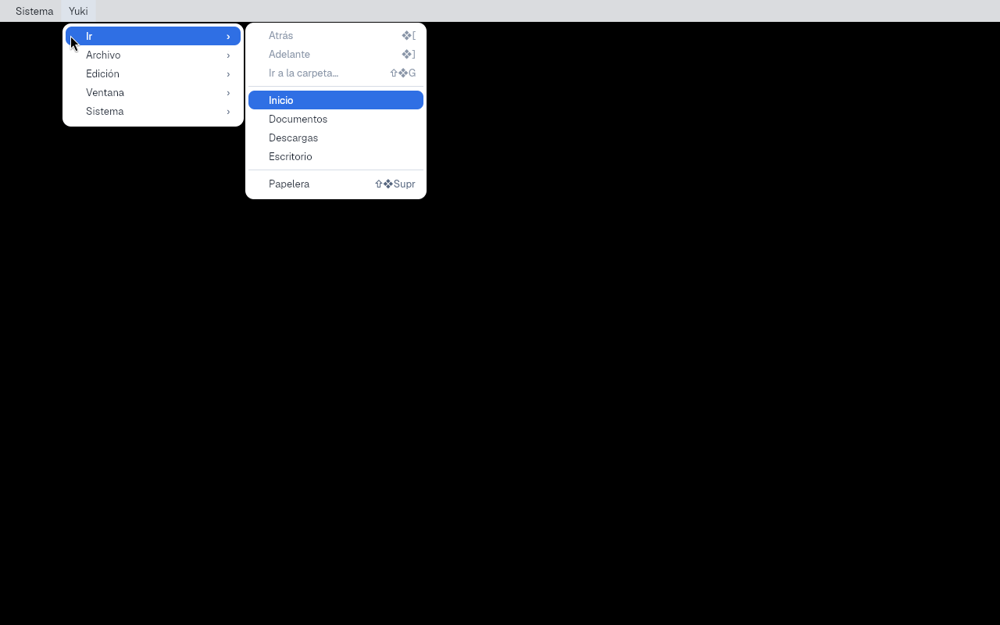

`ir-dark.png`: el mismo menú en oscuro.

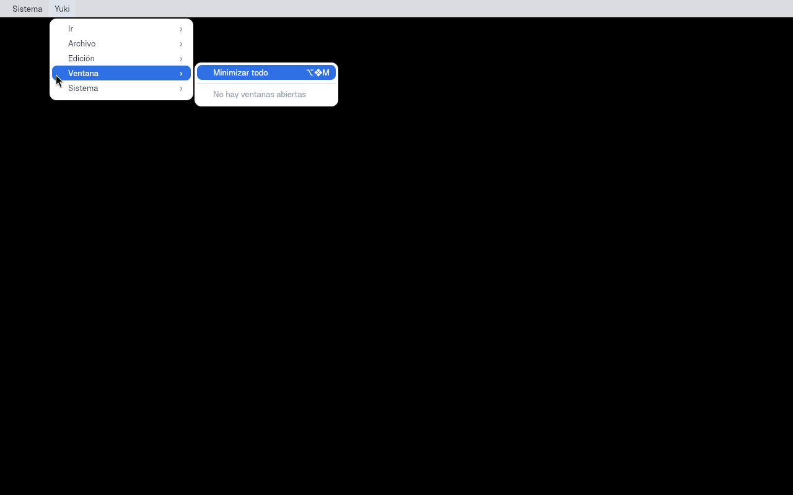

`ventana-light.png`: menú «Ventana» en claro con dos ventanas en la lista,
minimizadas para dejar ver el wallpaper.


`ventana-dark.png`: el mismo menú en oscuro.

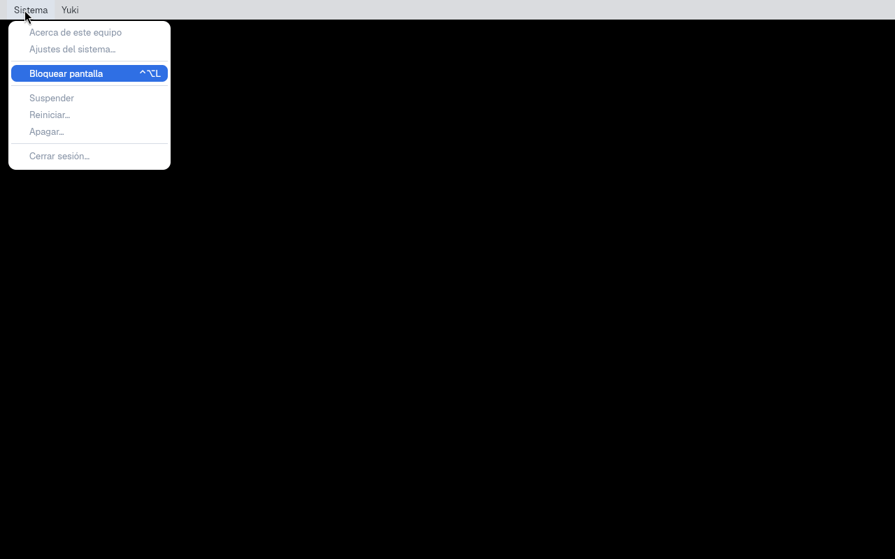

`sistema-light.png`: menú del copo en claro, con «Bloquear pantalla»
habilitado y «Forzar salida…» con `⌥❖⎋`.


`sistema-dark.png`: el mismo menú en oscuro.

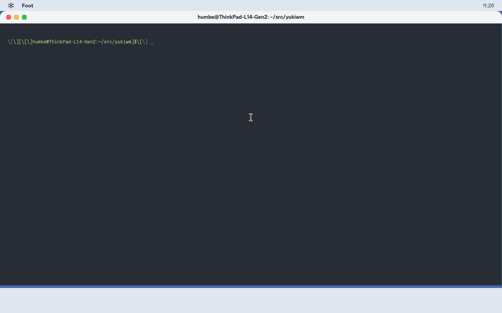

`foot-light.png`: `foot` enfocado; el nombre va en negrita y su barra de título
y semáforos quedan debajo de la menubar.

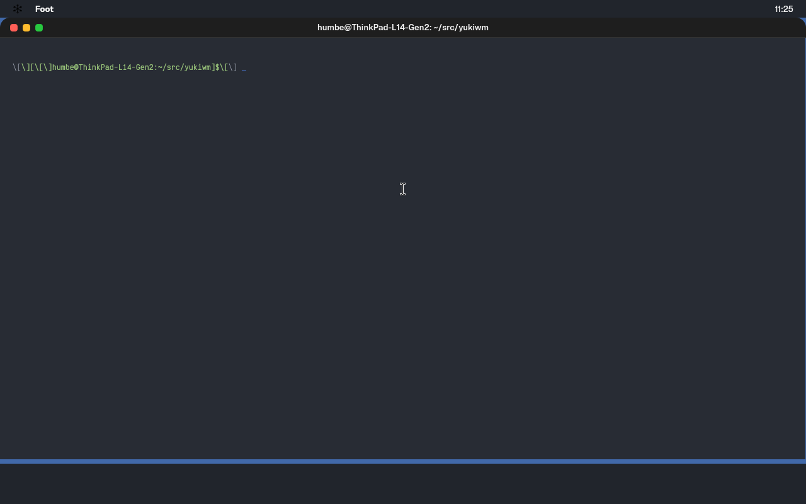

`foot-dark.png`: el mismo estado en oscuro.

## 14c — Menús de la app enfocada

Implementado el **2026-10-25**. Con una app enfocada la barra queda
**❄ · {App} · Ventana · Ayuda**; los tres títulos están habilitados y el nombre
va en negrita. Sin ventana enfocada no cambia nada del modo escritorio
(**Sistema**, **Yuki**, Archivo…).

### Piezas nuevas del kit

- `MenuItem::Action` y `MenuItem::Submenu` aceptan `icon: Option<&'static str>`.
  El SVG se dibuja a 14 px en la misma columna de 16 px que la marca de
  verificación (`✓`/radio): el icono no ensancha el menú. Color `ink-muted`
  normal, `on-accent` en la fila resaltada y `ink-faint` deshabilitado.
- `MenuItem::Header { label }`: 11 px, peso 600, `ink-faint`, altura 22 px,
  alineado a la columna del texto (no al icono). No es seleccionable y el teclado
  lo salta.
- `MenuItem::SearchField { placeholder }`: campo de 26 px con `bg-control`,
  anillo de acento de 2 px, lupa y un botón ✕ para borrar. Al recibir texto
  filtra las entradas buscables del menú (App, Ventana y sus submenús) y los
  temas de ayuda; muestra resultados en dos secciones con icono, heredan el
  atajo y permiten navegar con `↑`/`↓` y activar con `Enter`.
- `MenuItem::SearchResult { path, item, source, location }`: fila de una sola
  línea de 24 px con icono (ítem de menú o "?"), label y atajo. La ruta ya no
  se muestra en la fila; para los ítems de menú `location` permite revelar el
  menú real al resaltar el resultado.
- `format_shortcut` añade `← → ↑ ↓`, `↩` (Return/Enter) y `⇥` (Tab).
- `ToplevelInfo` añade `maximized` y `minimized`, leídos del evento `State` de
  `zwlr_foreign_toplevel_management_v1`. `Toplevels` expone
  `set_maximized(index, bool)` y `unset_minimized(index)`.

### Menú {App}

Acerca de {App} [info] (gris) · — · Configuración… [gear] `❖,` (gris) · — ·
Servicios › (submenú habilitado; dentro «Ningún servicio disponible» y
«Ajustes de servicios…», grises) · — · Ocultar {App} `❖H` · Ocultar otros
`⌥❖H` · Mostrar todo · — · Salir de {App} `❖Q`.

«Ocultar otros» se habilita si alguna ventana de otra app no está minimizada;
«Mostrar todo» solo si hay alguna minimizada. Ocultar minimiza todas las
ventanas de la app; Salir cierra todas con `close()`.

### Menú Ventana

Minimizar `❖M` · Maximizar · Rellenar `⌃❖↩` (gris) · Centrar `⌃❖C` (gris) · —
· Trasladar y redimensionar › [grid] (submenú habilitado, todo gris dentro) ·
Ventana a pantalla completa › [split] (todo gris dentro) · — · Cerrar ventana
`❖W` · — · Traer todo al frente · Quitar ventana del conjunto (gris) · — ·
pestañas anteriores/siguientes `⌃⇧⇥`/`⌃⇥`, mover pestaña y unir ventanas
(gris) · — · una entrada por ventana de la app, `{App} — {título}` (o `{App}`
si el título está vacío o es igual), con `Checkbox(true)` en la activa y
`activate(index)` al pulsarla.

«Trasladar y redimensionar» contiene los headers **Mitades**, **Cuartos** y
**Disposición**, con los iconos de mitad/cuarto, `← → ↑ ↓` en los atajos y los
cuatro cuartos. «Maximizar» alterna `set_maximized` sobre la activa.

### Menú Ayuda

SearchField «Buscar» · resultados filtrados debajo del campo · Ayuda de {App}
(gris) · — · Atajos de teclado de Yuki (gris) · Documentación de Yuki (gris) ·
Informar de un problema… (abre `https://github.com/HBlanqueto/yukiwm/issues` con
`xdg_open`).

El buscador indexa las entradas de **{App}**, **Ventana** y todos sus submenús.
Al escribir se reemplazan las entradas fijas del menú por los resultados que
contengan la subcadena (sin distinguir mayúsculas ni acentos); `Esc` vacía la
consulta y `Enter` activa el resultado resaltado.

Los atajos solo se muestran; **no** se crean keybindings. Un solo árbol de menús
abierto a la vez lo sigue garantizando `menubar/menu.rs`. Todos los fondos
salen de `Resolved` (`reduce_transparency`, ADR 0038): no hay alfa fijo.

### Iconos

`menubar/icons.rs` dibuja los iconos de disposición con `viewBox` 16: marco
`x=1.25 y=2.25 w=13.5 h=11.5 rx=2.2`, trazo 1.3, y la zona rellena dentro de
`x 2..14, y 3..13`. `grid` es el marco con cruz, `split` el marco con línea
vertical; además hay `info` (círculo con i) y `gear`.

### Capturas

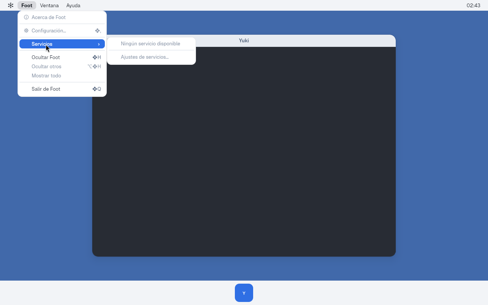

`10.png`: menú de Foot con **Servicios** desplegado; el icono de info y el gear
quedan separados de su etiqueta por 6 px, y el dock muestra su tile.

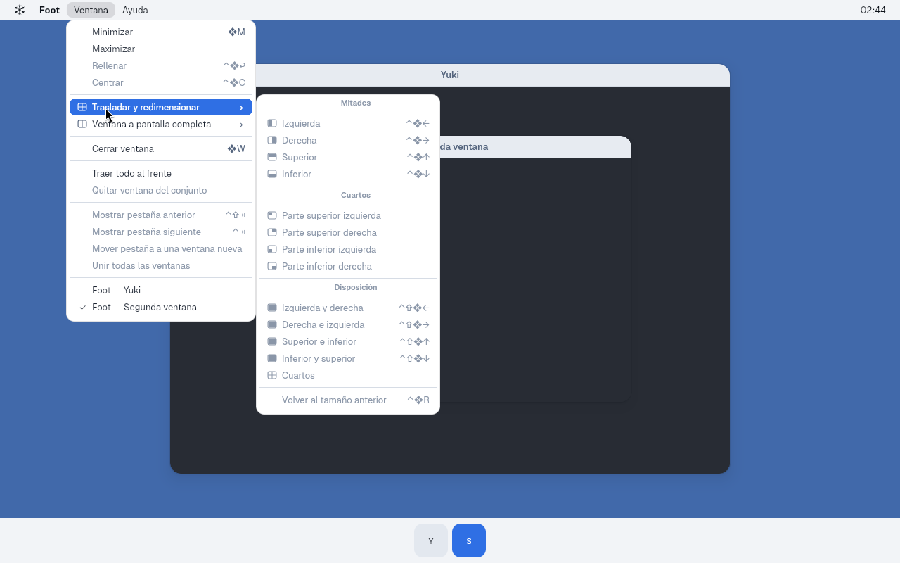

`11.png`: Ventana con **Trasladar y redimensionar** desplegado, Minimizar y
Maximizar habilitados, Rellenar y Centrar grises, la lista de ventanas de Foot y
`✓` en la activa (la segunda, con el mismo título que la primera no importa:
el estado viene de `ToplevelInfo`).

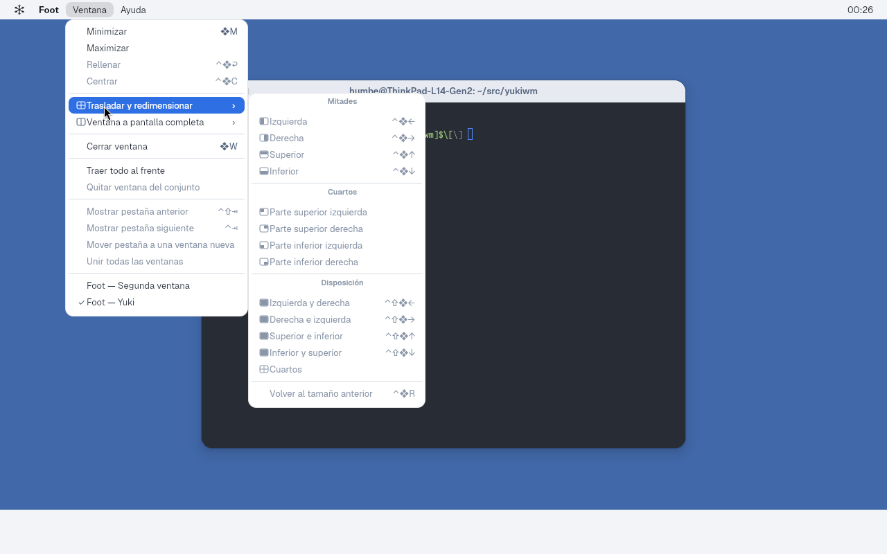

`12.png`: Ventana con **Ventana a pantalla completa** desplegado, su icono split
y solo el submenú habilitado.

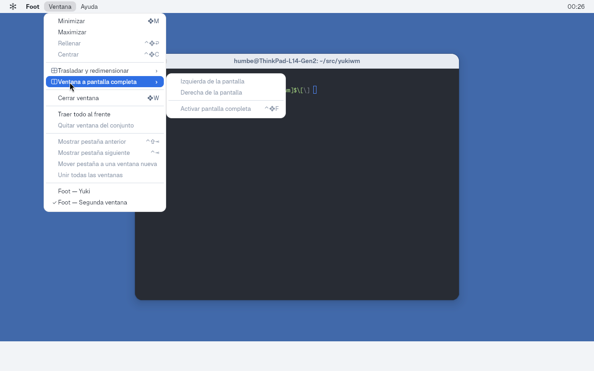

`12b.png`: menú Ayuda, con el buscador de 26 px, el anillo de acento y la lupa;
solo «Informar de un problema…» habilitado.

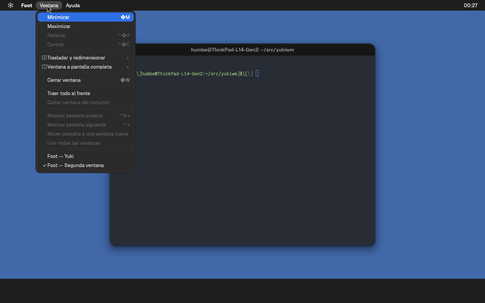

`11-dark.png`: el mismo Ventana con Trasladar y redimensionar abierto en oscuro.

Los mockups de `docs/bloques/img/14c/mockups/` no están en el repositorio; las
capturas se generaron con la especificación de este bloque y los nombres 10,
11, 12 y 12b, con los submenús abiertos como en los mockups.

### Prueba funcional con `YUKI_TEST_INPUT`

Sesión anidada en claro (`./dev.sh demo`, `yuki-shell wallpaper/menubar/dock`)
y **dos `foot -T Yuki`** de distinto tamaño (800×560 y 520×360) para que el
título no pueda distinguirlas: todo sale de `ToplevelInfo`. Extractos reales del
log del compositor (se omiten las líneas de geometría):

**El ✓ sigue a la ventana enfocada.** Clic en la ventana grande y luego en el
tile de la pequeña en el dock; el ✓ de Ventana pasa de la primera entrada a la
segunda, y el focus stack pasa de `focused=Some(WindowId(0))` a
`focused=Some(WindowId(1))`:

```text
app_id="foot" ... size 796x582 ... focused=false
app_id="foot" ... size 516x378 ... focused=true focused=Some(WindowId(1))
```

**Minimizar con el semáforo amarillo** (no desde la barra). La ventana pequeña
sale y el foco pasa a la grande; «Mostrar todo» queda habilitado (la captura de
la prueba lo muestra en negro, no gris):

```text
window minimized window=1
app_id="foot" ... hidden=true minimized=true ... focused=false
app_id="foot" ... hidden=false minimized=false ... focused=true focused=Some(WindowId(0))
```

**«Mostrar todo» las devuelve.** `window restored window=1`; la ventana vuelve
visible sin robar el foco a la grande.

**Ventana › Maximizar, dos veces.** El primer clic produce
`window maximized window=0` con `states=[0, 2]` (Maximized + Activated) y la
segunda `window restored window=0`; la geometría vuelve a
`x: 242, y: 91, 796×582`.

**Cerrar con el semáforo rojo.** El mismo frame del clic registra
`window removed windows=1 topmost=Some(WindowId(1))`; la lista de Ventana y el
dock se quedan con una sola entrada al instante.

**Dock.** Los tiles aparecen sin mover el puntero a la zona inferior: el cambio
de `Toplevels` despierta el loop (`sync_toplevels` hace `ping`) y el dock
repinta con el texto inactivo de `text`, no `on-accent`.

### Limitaciones conocidas

- En la sesión anidada con `window.domain` vacío la barra vuelve al modo
  escritorio; no hay «Mostrar todo» global en ese modo.
- El dock sigue eligiendo el tile resaltado por el título de `window.domain`:
  con dos ventanas del mismo título resalta las dos. La barra ya no usa ese
  respaldo.

## 14d — Menú real

Diseño cerrado en el [ADR 0040](../decisiones/0040-menu-global-real.md). Fases:

- **14d-1 — Compositor.** Sirve `org_kde_kwin_appmenu` y añade el evento
  `app_menu` a Infinity v2. La barra no cambia: solo loguea el evento.
- **14d-2 — Cliente y barra.** Hilo D-Bus con zbus, caché por ventana, carga
  perezosa, fusión de títulos y buscador de Ayuda.
- **14d-3 — Árbol completo y aceptación.** Prefetch del árbol completo en
  segundo plano y prueba con Kate, Firefox y GTK3. Las dos preferencias de
  Firefox viven en `~/nixdots`, nunca en el repo.
- **14e — Apps propias.** CelestialKit exporta dbusmenu por la misma vía, con la
  app Contador de los mockups 14 y 15.

14d no usa AT-SPI ni un atajo privado por Infinity: el respaldo de 14c sigue
siendo el modo sin menú real.

### 14d-1 — Compositor (implementado)

- `org_kde_kwin_appmenu_manager` v2, visible para todos los clientes. El par
  (servicio, ruta) se guarda por `wl_surface`, antes o después del map; se
  borra con `release`, al destruir el objeto y al destruir la superficie.
- Infinity v2: evento `app_menu` con `since=2`, emitido al cambiar el par
  (vacío = sin menú), al crear un handle wlr y al bindear el manager. Un
  manager v1 no recibe nada; el foco no dispara el evento.
- `ToplevelInfo.app_menu` y log de la barra al cambiar la ventana activa:
  `menubar: app_menu app_id=org.kde.kate service=:1.8 path=/MenuBar/2` o
  `... none`.
- Stub de aceptación `crates/yuki/examples/appmenu_registrar_stub.rs` (solo
  dev, `YUKI_LAB_REGISTRAR_STUB=1`): la barra aún no sirve el Registrar.

Aceptación no interactiva (15 s, Kate vía `nix shell`, lab con bus privado):

```text
INFO appmenu set window=5 service=:1.8 path=/MenuBar/2
menubar: app_menu app_id=org.kde.kate service=:1.8 path=/MenuBar/2
menubar: app_menu app_id=foot none
```

`busctl introspect` muestra `com.canonical.dbusmenu` con `GetLayout iias` y
`Version 4`; `GetLayout 0 1 0` devuelve el primer nivel de Kate: `_Archivo`,
`_Editar`, `Sele_cción`, `_Ver`, `_Ir`, `_Proyectos`, `Cliente _LSP`,
`_Sesiones`, `Herramientas`, `Preferencias`, `_Ayuda`. Sin el stub no hay
ninguna línea `appmenu set`, Kate queda `none` y el nombre del Registrar no
tiene dueño.

La hipótesis de 14d-1 se confirmó: Qt
(`QGenericUnixTheme::isDBusGlobalMenuAvailable` →
`isServiceRegistered("com.canonical.AppMenu.Registrar")`), KDE
(`checkDBusGlobalMenuAvailable`, salvo `KDE_NO_GLOBAL_MENU`) y Firefox
(`DBusMenuBar::OnNameOwnerChanged` exige `g_dbus_proxy_get_name_owner`) solo
exportan con el nombre ocupado.

### 14d-2 — Cliente, buscador e iconos (implementado)

Implementado el **2026-10-26** en sesión anidada con Kate 26.08.2. Cierra el
14d-2 del ADR 0040: hilo D-Bus, caché, fusión de títulos, buscador de Ayuda
sobre el árbol real, iconos de mapa de bits y `menubar.app_menus`.

**2a — hilo, caché y carga perezosa.** Un solo hilo posee la conexión de
sesión; la barra solo manda direcciones y recibe `Arc` inmutables, así que el
hilo de render nunca espera a D-Bus. El primer nivel se cachea por ventana y
los submenús se piden al abrirlos. Medidas del lab:

| Medida | Valor |
|---|---|
| Primer nivel en frío (`root snapshot … cached=false`) | 1 ms |
| Primer nivel al recuperar el foco (`cached=true`) | 0 llamadas |
| Llamadas D-Bus desde el hilo de render | 0 (la aserción de depuración nunca saltó) |

**2b — revisión y señales.** La caché guarda la revisión de dbusmenu;
`LayoutUpdated` invalida solo el subárbol afectado (y el árbol completo del
buscador si la revisión es mayor) y `ItemsPropertiesUpdated` actualiza los
ítems en sitio. Los tests cubren la invalidación por revisión, el árbol
completo y las propiedades anidadas. El cierre por `SIGTERM` del lab no llega
a ejecutar el log de `render_dbus_calls`: la comprobación es la
`debug_assert_eq!(calls, 0)` de `run()`.

**2c — Ayuda real, iconos y apagado.**

- **Buscador.** Abrir **Ayuda** envía `FullTree` (`GetLayout(0, -1, [])`) al
  hilo D-Bus con el timeout de 500 ms. El árbol se cachea por revisión y
  cualquier `LayoutUpdated` de esa dirección lo invalida. `remote::searchable`
  recorre los títulos ya compuestos, indexa solo acciones (hojas) con su ruta
  y su `SearchLocation`, y mantiene las deshabilitadas en gris sin activarlas.
  Las fuentes de resultados y de raíces a revelar se releen en cada render, así
  que los resultados que llegan mientras se escribe no pierden texto,
  selección ni scroll.
- **Medida de apertura.** `full tree snapshot … ms=354` en frío (354–478 ms en
  dos sesiones, por debajo del límite de 500) y `ms=0` con el árbol cacheado.
  Con «nuev» salen 8 filas; «Archivo › Nueva ventana» y «Archivo › Nuevo»
  están entre ellas. `Enter` sobre «Archivo › Nuevo» abrió **Sin título —
  Kate**.
- **Revelar.** `↓` sobre un resultado abre el menú real de su título con los
  hijos del árbol completo (nunca «Cargando…»). El popup se coloca a la
  izquierda del de Ayuda, alineado arriba con 8 px de separación; sin ese
  ajuste el compositor lo mandaba fuera de pantalla por arriba.
- **Iconos.** Kate manda `icon-name` en 89 entradas y ninguna `icon-data`
  (219 labels, 34 submenús). Solo 3 nombres caen en el conjunto estático de la
  barra (`view-split-left-right` → icono de división); el resto se ignora con
  `debug!`. `icon-data` se admite como PNG: se decodifica una vez, se escala
  al tamaño del icono y se cachea por hash; por encima de 64 KiB o si falla la
  decodificación no se dibuja y se registra en `debug!`.
- **`menubar.app_menus`.** Con `false` en `menubar.domain` la barra no pide
  layouts y el hilo suelta `com.canonical.AppMenu.Registrar` (`busctl` no
  muestra el nombre); la barra queda en el respaldo de 14c
  ({App} · Ventana · Ayuda) y Kate pinta su propia barra de menús. Al poner
  `true` el nombre vuelve en el siguiente tick de 500 ms, pero Kate no cambia
  al menú global sin reiniciarse: su barra propia y el respaldo siguen ahí.
  Es un límite conocido, no se fuerza el re-registro de la app.

Capturas del lab (Kate enfocado, árbol completo cacheado):

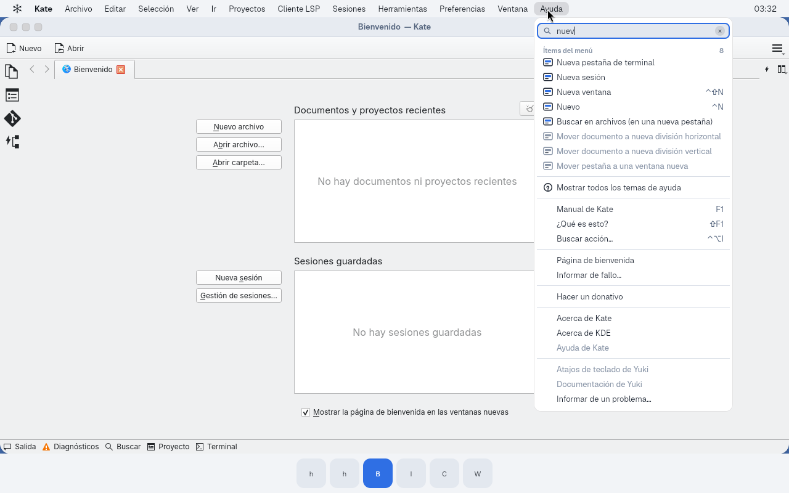

`buscar-kate-claro.png`: Ayuda con «nuev», 8 resultados del árbol real y el
menú de la app compuesto; el campo conserva el texto y la lista su scroll.

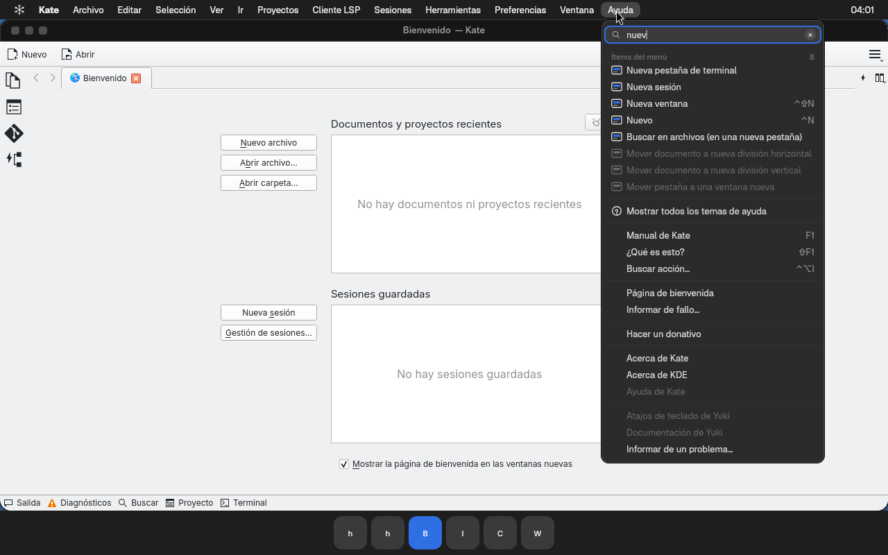

`buscar-kate-oscuro.png`: el mismo estado en tema oscuro.

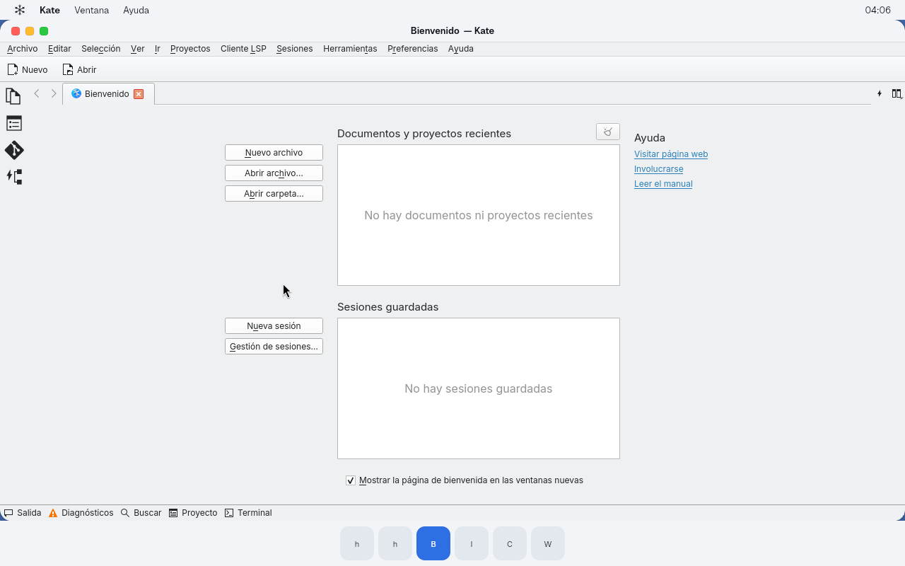

`kate-sin-menu-global.png`: `menubar.app_menus = false`; la barra muestra solo
Kate · Ventana · Ayuda y Kate pinta su propia barra de menús.

### 14d-3 — Árbol completo en segundo plano y aceptación (implementado)

Implementado el **2026-10-26** en sesión anidada con Kate 26.08.2 y Firefox
158.0. `GetLayout(0, -1, [])` medía 354–478 ms con el límite de 500 ms de las
demás llamadas, así que el árbol completo pasa a tener su propio timeout de
**2 s** (`FULL_TREE_TIMEOUT`); el resto sigue en 500 ms. El hilo D-Bus pide
`FullTree` **1 s después del foco** si la ventana sigue enfocada, si aún no hay
árbol completo cacheado para esa revisión y si no hay ya una petición pendiente
para esa dirección. La barra sigue usando la caché al abrir Ayuda y, si aún no
está, la pide como antes. La petición de fondo no bloquea el render: vive en el
hilo D-Bus; si el foco se pierde durante la espera, la barra manda `Unfocus`,
se cancela la petición y no se envía snapshot (si el resultado llega igual, se
cachea y la generación antigua lo descarta). Los tests puros cubren el
temporizador de 1 s y la deduplicación por dirección.

**Kate.** `appmenu set window=5 service=:1.6 path=/MenuBar/2`; primer nivel en
1 ms. Un segundo después del foco, el prefetch de fondo tarda **362–710 ms**
en cinco sesiones (`dbusmenu full tree prefetch … items=11 focused=true`, la
última con `ms=709`). Al volver a enfocar Kate y abrir **Ayuda**,
`full tree snapshot … items=11 cached=true ms=0` dos veces: la primera apertura
ya no espera a D-Bus.

**Firefox.** Con las dos preferencias del perfil temporal del lab,
`appmenu set window=7 service=:1.8 path=/com/canonical/menu/0`. Firefox
publica el menú tarde: el primer `root snapshot` llega con 0 títulos y el
`LayoutUpdated` posterior trae los 7 (`File`, `Edit`, `View`, `History`,
`Bookmarks`, `Tools`, y nuestros `Ventana`/`Ayuda`). El prefetch de ese primer
foco cachea un árbol vacío (0 ítems) y la revisión nueva lo invalida; Ayuda lo
pide entonces en primer plano. Abrir **File** pide el submenú `id=1954` (18
ítems, 2 ms) y pinta **New Tab** (la app está en inglés). Captura:

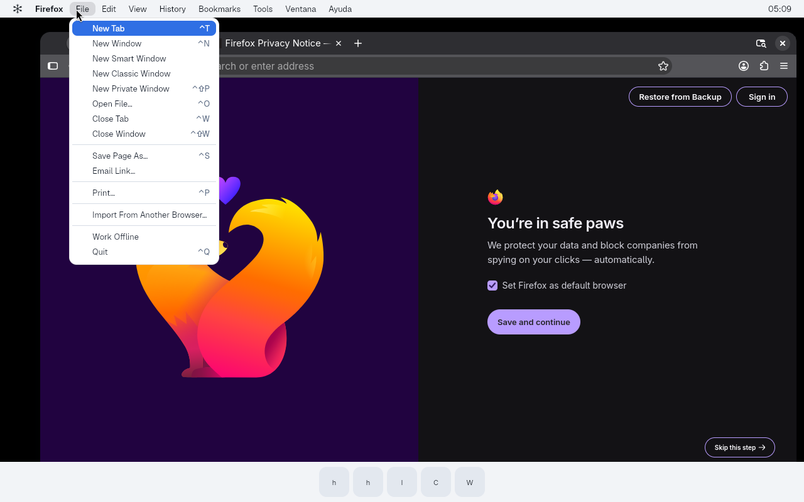

**GTK3.** `appmenu-gtk-module` (vala-panel-appmenu) en Wayland no usa
`org_kde_kwin_appmenu` ni el Registrar con un id X11: exporta el `GMenuModel`
del `GtkApplicationWindow` por la conexión D-Bus de la propia app y llama a
`gdk_wayland_window_set_dbus_properties_libgtk_only`, es decir, la vía
`gtk_shell1`/`org.gtk.Menus` (fuente 3 del ADR 0040, fuera de 14d). Su
`wayland/org.kde.appmenu.xml` se genera pero ningún `.c` lo usa; en X11 solo
publica `_GTK_MENUBAR_OBJECT_PATH` para que lo lea el panel. Por eso no hay
commit de shell en 14d-3: el casado por pid del Registrar queda **pendiente de
XWayland** y GTK necesita `gtk_shell1`/`org.gtk.Menus` en una fase posterior.
El paquete `appmenu-gtk3-module` tampoco existe en nixpkgs (`does not provide
attribute … appmenu-gtk3-module`), así que no hubo prueba con `gtk3-demo`.

**Limitaciones conocidas.**

- Qt no vuelve al menú global sin reiniciar tras `menubar.app_menus`
  `false → true`: la barra recupera el nombre del Registrar, pero Kate sigue
  pintando su propia barra hasta relanzarse.
- Firefox publica el menú después del primer foco; el prefetch de fondo no se
  reintenta, aunque el `LayoutUpdated` refresca el primer nivel y el árbol
  completo se pide on demand.
- GTK3 no entra en 14d: `appmenu-gtk-module` depende de `gtk_shell1`.
- Con muchos títulos la barra recorta por la derecha (sin menú de
  desbordamiento), como ya fijó el ADR 0040 §6.


## Aceptación de 14a

Aceptado el **2026-10-24** en el ThinkPad, en sesión anidada, con prueba manual:

- Clic: abre el menú.
- Submenús por hover.
- Teclado: navegación con redibujado inmediato.
- Esc cierra por niveles (primero el popup más profundo).
- Clic fuera cierra toda la cascada.
- Un solo árbol abierto a la vez.
- Al cerrar, el foco vuelve a `foot`.
- `kill -9` del cliente no deja restos (ni popups huérfanos ni foco perdido).

## Capturas


`menubar-nombre-claro.png`: menubar real con `foot` enfocado; muestra «Foot»,
no el título de la ventana, en negrita y con la pila Geist.


`menubar-nombre-oscuro.png`: el mismo estado en tema oscuro, «Foot» en
`ink-strong`.

Sesión anidada (`./dev.sh demo`: wallpaper, menubar real, dock y ventanas) con
el ejemplo en cada caso y captura por `SIGUSR1`. Claro y oscuro se obtienen
escribiendo `color_scheme = "light"|"dark"` en `appearance.domain` y apuntando
`YUKI_CONFIG_DIR` a ese directorio para el demo y el ejemplo. El texto de los
menús sale en Geist; los glifos ⌃⌥⇧❖, en Inter (el respaldo fijo de la pila).


`ir-claro.png`: menú «Ir» en tema claro, «Inicio» resaltado y «⌥Inicio»,
«⇧❖D», «⌥❖L», etc. completos.


`ir-oscuro.png`: el mismo menú «Ir» en tema oscuro.


`editar-sub-claro.png`: «Editar» + «Ordenar por» + «Orden» (raíz, hijo y
nieto), con «Deshacer», «Nombre» y «Ascendente» resaltados; cada submenú
empieza a la altura de la fila que lo abre.


`editar-sub-oscuro.png`: el mismo árbol de tres niveles en oscuro.


`borde-claro.png`: «Editar» abierto desde el borde derecho; el compositor
voltea el raíz y sus descendientes hacia la izquierda. El árbol de tres niveles
queda entero a la izquierda, pegado al raíz sin solaparse.


`borde-flip-claro.png`: detalle del primer submenú «Nombre», volteado a la
izquierda por el compositor; su borde derecho coincide con el izquierdo del
raíz, su fila coincide con «Ordenar por» y el ejemplo no tiene ninguna rama
especial para abrirlo a la izquierda.


`borde-oscuro.png`: la misma disposición de borde en oscuro, con el borde
doble visible en los paneles.


`borde-doble-oscuro.png`: zoom ×4 del borde superior de un panel oscuro; se ve
la línea exterior negra (`window-outer`) y la interior clara (`window-inner`).


`teclado-1.png`: clic en «Editar»; el título se resalta y el menú se abre con
«Deshacer» enfocado, pegado al borde inferior de la barra.

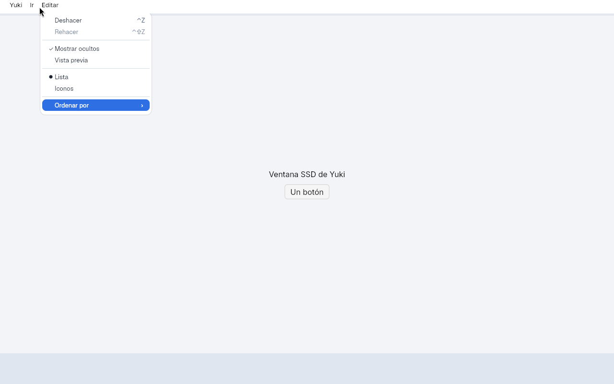

`teclado-2.png`: `key:Down` × 5; el foco salta «Rehacer», separadores y items
no seleccionables hasta «Iconos».

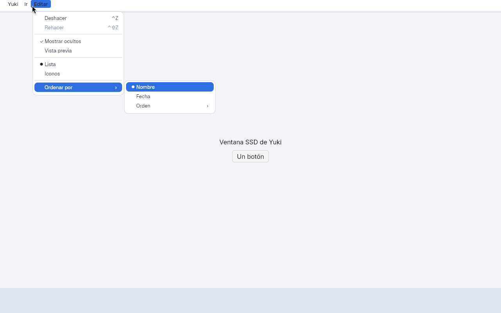

`teclado-3.png`: `key:Right` abre el submenú con «Nombre» enfocado.

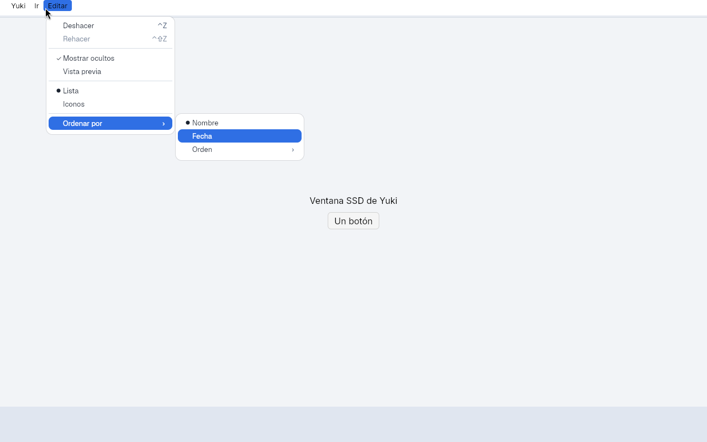

`teclado-4.png`: `key:Down` mueve el foco a «Fecha». La secuencia usa solo
teclado.

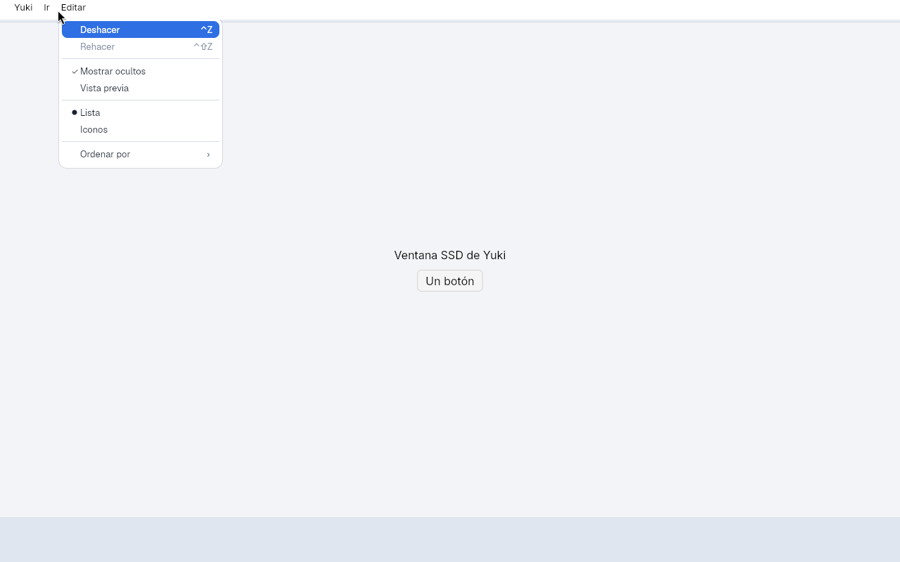

`menus-anchos.png`: mismo menú con los tokens ajustados: ancho mínimo 220 px,
`shortcut-gap` 24 px, relleno derecho 10 px y ancla pegada al borde inferior
de la barra con el título resaltado.

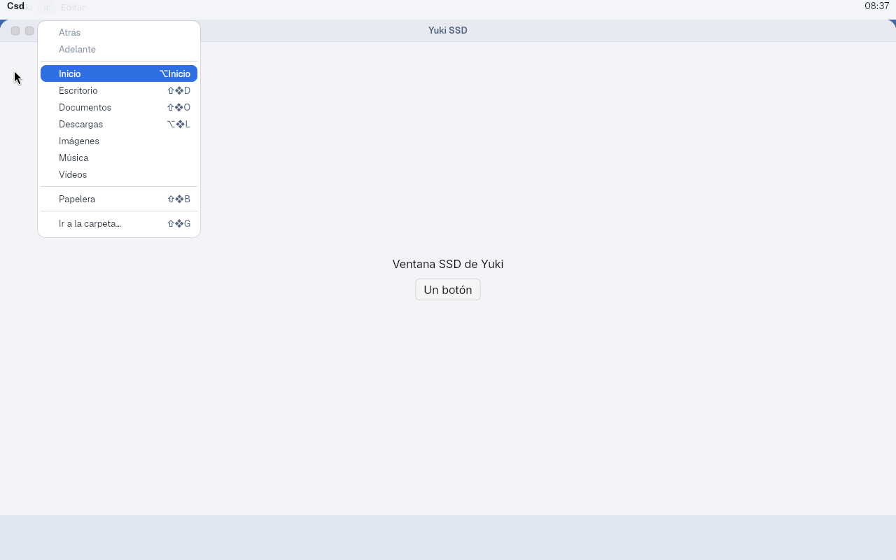

`pegado-a-la-barra.png`: menú «Ir» abierto; el panel arranca exactamente en el
borde inferior de la barra, sin espacio, y el título «Ir» permanece
resaltado.

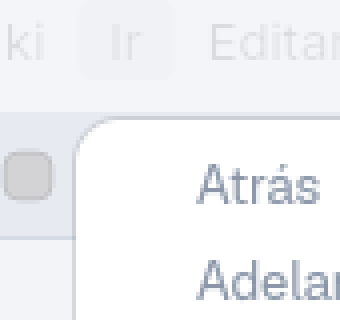

`pegado-a-la-barra-zoom.png`: zoom ×4 de la unión entre el título resaltado y
el borde superior del panel; no hay hueco entre ambos.


`un-solo-arbol.png`: se abrió «Yuki» y se pulsó «Editar`; el menú de «Yuki» se
cerró y solo sobrevive el árbol de «Editar», demostrando que `toggle_menu`
/cierra el árbol anterior antes de abrir uno nuevo.

Nota de honestidad: la barra del ejemplo comparte la franja superior con el
menubar real del demo y queda debajo de él, así que el título visible sobre el
menú es el de la ventana activa, no las etiquetas «Ir»/«Editar»/«Borde» del
ejemplo. El menú sí está anclado en la posición de esas etiquetas.

## Divergencias

- **Prerrequisito de los popups de layer**: los menús no se veían hasta
  `ab8e0b5`; faltaba `WlrLayerShellHandler::new_popup` en el compositor y el
  primer buffer del cliente. Está corregido y documentado en la
  [nota del Bloque 5](05-popups.md#nota-2026-10-23-popups-hijos-de-layer-shell).
- **Sombra (`shadow-float`)**: el cliente no la dibuja. El panel solo pinta el
  fondo, los bordes `window-outer`/`window-inner` y el contenido; la sombra de
  la ventana flotante la aplicará el compositor, como indica ADR 0024. Esto
  evita que cada popup cliente renderice una sombra que luego el compositor
  componga de todos modos.

## Pendiente

- Repetir la prueba de 14a y 14b-1 en DRM real (pendiente de 8b/14b).
- 14b-2: diálogos del sistema (Suspender, Reiniciar, Apagar, Cerrar sesión).
- Aceptación manual de 14c en DRM (con el protocolo completo).
- Navegación por teclado completa dentro de los popups (flechas, Esc, Enter)
  y atajos subrayados al pulsar `Alt`.
- Scroll para menús largos.
